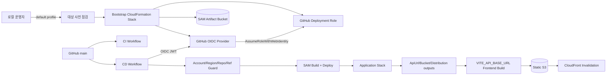
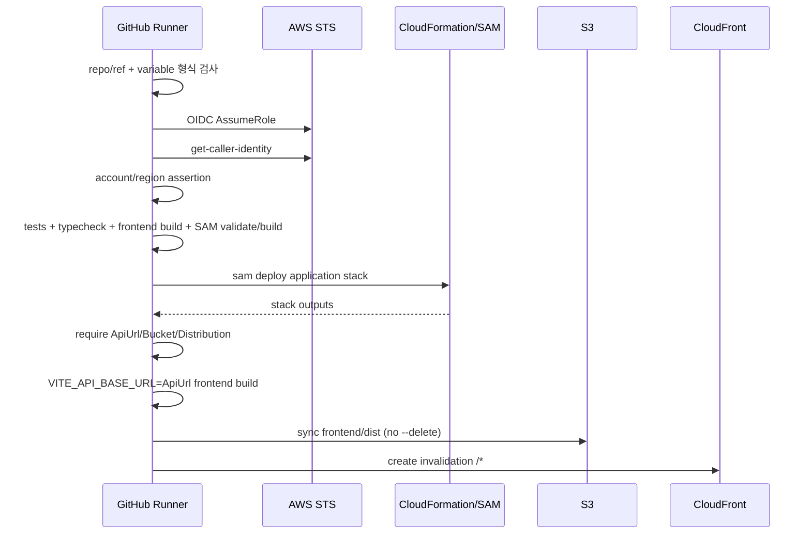

# Design Document

## Overview

`aws-deployment-cicd`는 `haramsong/kirothon-team-015`의 검증과 AWS 배포를 GitHub Actions로 자동화합니다. 로컬 운영자는 `default` 프로파일로 계정 `462747820533`과 `ap-northeast-2`를 확인한 뒤 별도 CloudFormation 부트스트랩 스택을 생성합니다. GitHub Actions는 부트스트랩 스택의 IAM 역할을 OIDC로 수임하므로 장기 AWS 액세스 키를 저장하지 않습니다.

기존 `template.yaml`과 애플리케이션 구조는 유지합니다. 새 구성은 다음 경계로 나눕니다.

- `infra/github-oidc-bootstrap.yaml`: GitHub OIDC 공급자, 저장소·브랜치 제한 배포 역할, SAM 아티팩트 버킷
- `scripts/deployment/`: 대상 확인, 부트스트랩, 애플리케이션 배포, GitHub 변수/dispatch 자동화
- `.github/workflows/ci.yml`: 외부 변경이 없는 CI
- `.github/workflows/cd.yml`: `main` push와 `workflow_dispatch` CD
- `tests/deployment/`: 템플릿, workflow, 스크립트 안전 경계 자동 검사
- `docs/aws-deployment-runbook.md`: 최초 배포, 운영, 장애 확인과 롤백

승인된 고정값은 다음과 같습니다.

| 항목                  | 값                                                                         |
| --------------------- | -------------------------------------------------------------------------- |
| AWS account           | `462747820533`                                                             |
| AWS region            | `ap-northeast-2`                                                           |
| Local profile         | `default`                                                                  |
| GitHub repository     | `haramsong/kirothon-team-015`                                              |
| Deployment branch/ref | `main` / `refs/heads/main`                                                 |
| Bootstrap stack       | `my-own-fridge-github-oidc`                                                |
| Application stack     | `my-own-fridge`                                                            |
| OIDC subject          | `repo:haramsong@61612250/kirothon-team-015@1457328764:ref:refs/heads/main` |

GitHub workflow의 AWS 명령은 OIDC action이 제공한 단기 환경 자격 증명을 사용합니다. `default` 프로파일은 로컬 STS, CloudFormation, SAM 명령에만 강제합니다. GitHub runner에 장기 키나 자격 증명 파일을 만들지 않습니다.

### 외부 기준

- GitHub OIDC의 AWS provider URL은 `https://token.actions.githubusercontent.com`, audience는 `sts.amazonaws.com`이고, AWS 역할 신뢰 정책은 `sub` 조건으로 저장소와 branch를 제한합니다. [GitHub OIDC와 AWS 구성](https://docs.github.com/en/actions/how-tos/secure-your-work/security-harden-deployments/oidc-in-aws)
- `AWS::IAM::OIDCProvider`는 thumbprint를 생략하면 IAM이 인증서 체인의 CA thumbprint를 가져옵니다. 이 설계는 고정 thumbprint를 저장하지 않습니다. [AWS::IAM::OIDCProvider](https://docs.aws.amazon.com/AWSCloudFormation/latest/UserGuide/aws-resource-iam-oidcprovider.html)
- SAM은 GitHub Actions OIDC와 저장소·브랜치 제한 배포 구성을 지원합니다. [AWS SAM OIDC 배포](https://docs.aws.amazon.com/serverless-application-model/latest/developerguide/deploying-with-oidc.html)

외부 문서 내용은 라이선스 준수를 위해 요약했습니다.

## Architecture



### 신뢰 경계

1. 로컬 경계: `scripts/deployment/assert-target.sh`가 `git remote`, 현재 branch, AWS STS account와 region을 검증합니다.
2. GitHub 경계: `cd.yml`은 `github.repository`, `github.ref`, OIDC 수임 후 STS account와 configured region을 검증합니다.
3. CloudFormation 경계: 배포 역할 trust policy는 audience와 subject 모두 `StringEquals`를 사용합니다. wildcard를 쓰지 않습니다.
4. 산출물 경계: 정적 파일 대상은 CD 입력이 아니라 Application Stack output에서만 얻습니다.
5. 순서 경계: 각 배포 단계는 선행 단계 성공 후 실행됩니다. output 하나라도 비면 프론트엔드 build 전 중단합니다.
6. Git 경계: 작업 자동화는 `main`, `origin=https://github.com/haramsong/kirothon-team-015.git` 또는 동등한 SSH URL만 허용하고 task별 파일만 stage합니다.

## Components and Interfaces

### 1. 배포 설정

`scripts/deployment/config.sh`는 shell readonly 상수만 제공합니다.

```bash
readonly EXPECTED_AWS_ACCOUNT='462747820533'
readonly AWS_REGION='ap-northeast-2'
readonly AWS_PROFILE='default'
readonly GITHUB_REPOSITORY='haramsong/kirothon-team-015'
readonly DEPLOY_BRANCH='main'
readonly BOOTSTRAP_STACK_NAME='my-own-fridge-github-oidc'
readonly SAM_STACK_NAME='my-own-fridge'
```

스크립트는 `set -Eeuo pipefail`을 사용하고 입력값을 quote합니다. 실제 AWS 변경 함수는 target guard 성공을 나타내는 프로세스 내부 flag가 없으면 실행되지 않습니다.

### 2. OIDC Bootstrap Template

`infra/github-oidc-bootstrap.yaml`은 일반 CloudFormation 템플릿이며 애플리케이션 `template.yaml`과 수명주기를 분리합니다.

#### Parameters와 Conditions

- `GitHubOwner`: default와 allowed value `haramsong`
- `GitHubRepository`: default와 allowed value `kirothon-team-015`
- `GitHubBranch`: default와 allowed value `main`
- `ApplicationStackName`: default와 allowed value `my-own-fridge`
- `ExistingGitHubOidcProviderArn`: 기본 빈 문자열
- `CreateGitHubOidcProvider`: 기존 provider ARN이 없을 때만 provider 생성

Bootstrap script는 account의 provider 목록에서 URL이 `token.actions.githubusercontent.com`인 provider를 찾습니다. 정확히 하나면 ARN을 parameter로 넘기고, 없으면 새 provider를 생성합니다. 둘 이상이거나 다른 account ARN이면 변경 전에 실패합니다. 이 방식은 account당 같은 URL provider가 이미 있을 때 중복 생성 실패를 막고 기존 provider를 stack 삭제 대상으로 편입하지 않습니다.

#### Resources

- `GitHubOidcProvider`: condition부 `AWS::IAM::OIDCProvider`
  - URL: `https://token.actions.githubusercontent.com`
  - ClientIdList: `sts.amazonaws.com`
  - `ThumbprintList` 생략
- `SamArtifactBucket`: S3-managed encryption, public access block, bucket owner enforced, versioning
- `GitHubDeploymentRole`: OIDC trust와 inline deployment policy

Trust policy 핵심은 다음과 같습니다.

```yaml
Condition:
  StringEquals:
    token.actions.githubusercontent.com:aud: sts.amazonaws.com
    token.actions.githubusercontent.com:sub: repo:haramsong@61612250/kirothon-team-015@1457328764:ref:refs/heads/main
```

배포 역할의 session duration은 1시간입니다. policy는 다음 범주로 분리하고 `Resource: "*"`가 불가피한 action을 test allowlist에 명시합니다.

| Sid                               | 용도                                                                | 범위                                                        |
| --------------------------------- | ------------------------------------------------------------------- | ----------------------------------------------------------- |
| `ApplicationStackManagement`      | change set 및 stack 배포/조회                                       | `my-own-fridge` stack ARN                                   |
| `SamTransformInspection`          | transform/template 검증                                             | AWS API가 resource scope를 지원하지 않는 읽기 action만 `*`  |
| `ArtifactBucketAccess`            | SAM package upload                                                  | bootstrap artifact bucket과 objects                         |
| `ApplicationResourceProvisioning` | Lambda, DynamoDB, API Gateway, S3, CloudFront 리소스의 CF 생성/수정 | stack-name prefix 또는 서비스가 지원하는 최소 resource 범위 |
| `ApplicationRoleManagement`       | SAM 생성 Lambda role 관리와 pass role                               | `arn:aws:iam::462747820533:role/my-own-fridge-*`            |
| `StaticSiteDeployment`            | stack output 버킷 sync와 distribution invalidation                  | `my-own-fridge-*` S3 ARN, CloudFront distribution resource  |

CloudFormation이 생성 전 물리 ID를 알 수 없어 resource-level 제한을 지원하지 않는 일부 `cloudfront`, `apigateway`, `iam:GetRole`, `s3:ListAllMyBuckets` read/create action은 `Resource: "*"`가 필요할 수 있습니다. 허용 action을 개별 열거하며 AWS 관리형 `AdministratorAccess`, `PowerUserAccess`는 사용하지 않습니다. 실제 첫 OIDC dispatch에서 AccessDenied가 발생하면 필요한 action 하나를 근거와 함께 추가하고 별도 commit으로 검토합니다.

Outputs:

- `GitHubDeploymentRoleArn`
- `SamArtifactBucketName`
- `OidcProviderArn`

### 3. Target Guard와 Bootstrap Script

`scripts/deployment/assert-target.sh`의 interface:

```text
assert_local_aws_target()
  input: aws sts account, configured region
  success: account=462747820533 and region=ap-northeast-2
  failure: stderr + non-zero, no mutating command

assert_git_target()
  input: git branch, origin URL
  success: main and haramsong/kirothon-team-015
  failure: stderr + non-zero

assert_github_target(repository, ref, account, region)
  success: exact four-value match only
```

`scripts/deployment/bootstrap-oidc.sh`:

1. 필수 명령 `aws`, `git` 확인
2. `assert_git_target`
3. `aws sts get-caller-identity --profile default --region ap-northeast-2`
4. configured region과 account assertion
5. 기존 GitHub OIDC provider 탐색 및 0/1개 판정
6. `aws cloudformation validate-template --template-body file://... --profile default --region ap-northeast-2`
7. `aws cloudformation deploy --stack-name my-own-fridge-github-oidc --capabilities CAPABILITY_NAMED_IAM ... --profile default --region ap-northeast-2`
8. stack complete waiter
9. output 조회 후 ARN account와 non-empty artifact bucket 검증
10. 사람이 복사할 수 있는 non-secret output만 JSON으로 표시

스크립트에는 stack 삭제, IAM detach/delete, OIDC provider 삭제 명령을 넣지 않습니다.

### 4. CI Workflow

`.github/workflows/ci.yml` trigger:

```yaml
on:
  pull_request:
    branches: [main]
  push:
    branches: [main]
  workflow_dispatch:
permissions:
  contents: read
```

CI job은 `ubuntu-latest`, Python `3.13`, Node `22`를 사용합니다. `.nvmrc`에 `22`를 기록하고 setup action과 local 문서가 같은 값을 읽습니다. action major version은 구현 시 검증된 공식 action 버전으로 고정합니다.

실행 순서:

1. checkout
2. Python 3.13, Node 22, SAM CLI setup
3. `python -m pip install -r backend/requirements-dev.txt`
4. `npm --prefix frontend ci`
5. `python -m pytest backend/tests`
6. `npm --prefix frontend run test`
7. `npm --prefix frontend run typecheck`
8. `npm --prefix frontend run build`
9. `sam validate --template-file template.yaml --region ap-northeast-2`
10. `sam build --template-file template.yaml`
11. deployment spec tests

CI는 `id-token: write`, configure-aws-credentials, AWS key secret을 갖지 않습니다. SAM validate/build는 외부 AWS 변경을 하지 않습니다.

`scripts/validate-ci.sh`는 같은 프로젝트 명령을 비대화형으로 실행합니다. 기존 `scripts/verify-all.sh`를 재사용하고 bootstrap template validation은 로컬에서 `default` profile과 region을 명시합니다. 테스트는 개발 서버나 watcher를 시작하지 않습니다.

### 5. CD Workflow

`.github/workflows/cd.yml` trigger와 concurrency:

```yaml
on:
  push:
    branches: [main]
  workflow_dispatch:
permissions:
  contents: read
  id-token: write
concurrency:
  group: my-own-fridge-production
  cancel-in-progress: false
```

Repository variables:

| Name                  | Value source                               |
| --------------------- | ------------------------------------------ |
| `AWS_ROLE_ARN`        | Bootstrap output `GitHubDeploymentRoleArn` |
| `AWS_REGION`          | `ap-northeast-2`                           |
| `SAM_STACK_NAME`      | `my-own-fridge`                            |
| `SAM_ARTIFACT_BUCKET` | Bootstrap output `SamArtifactBucketName`   |

CD는 하나의 `deploy` job에서 검증과 배포를 직렬 실행해 검증한 checkout SHA와 배포 SHA가 같도록 합니다.



CD 명령 규칙:

- OIDC 수임 전에는 AWS 변경 명령이 없습니다.
- `aws-actions/configure-aws-credentials`에는 `role-to-assume`, `aws-region`, `role-session-name`을 지정합니다. 역할 ARN을 승인된 계정의 고정값으로 검사한 뒤 수임하고, 다음 단계에서 STS account가 `462747820533`인지 다시 확인합니다.
- runner에서는 OIDC 단기 환경 자격 증명을 사용하고 credential file을 생성하지 않습니다.
- `sam deploy`는 `--s3-bucket "$SAM_ARTIFACT_BUCKET"`, `--capabilities CAPABILITY_IAM`, `--no-confirm-changeset`, `--no-fail-on-empty-changeset`, `--stack-name`, `--region`을 명시합니다.
- output은 한 번의 `describe-stacks` JSON 응답을 `jq -er`로 key별 추출합니다.
- `ApiUrl`의 마지막 `/`는 frontend client가 `/api/...`를 중복 slash 없이 붙일 수 있도록 제거한 후 `VITE_API_BASE_URL`로 전달합니다.
- S3 sync는 예전 hashed asset을 즉시 삭제하지 않도록 `--delete`를 사용하지 않습니다. `index.html`과 새 asset은 갱신됩니다.
- CloudFront invalidation은 sync 성공 뒤 한 번만 생성합니다.

### 6. 최초 배포 자동화

`scripts/deployment/deploy-application.sh`는 로컬 최초 배포와 수동 복구에 사용합니다.

1. local AWS와 git target assertion
2. Bootstrap stack output에서 artifact bucket 조회
3. `sam build --profile default --region ap-northeast-2`
4. `sam deploy ... --s3-bucket <bootstrap-output> --profile default --region ap-northeast-2`
5. Application stack의 세 output 조회 및 account/region/형식 검사
6. `VITE_API_BASE_URL=<ApiUrl> npm --prefix frontend run build`
7. `aws s3 sync frontend/dist s3://<StaticBucketName> --profile default --region ap-northeast-2`
8. `aws cloudfront create-invalidation --distribution-id <DistributionId> --paths '/*' --profile default --region ap-northeast-2`

`scripts/deployment/first-deploy.sh`는 `bootstrap-oidc.sh` 성공 후 `deploy-application.sh`를 호출합니다. `--yes`나 자동 승인 flag를 받지 않습니다. 스크립트 시작 시 고정 대상 요약을 표시하고 운영자가 account/repository를 입력해 확인하도록 하지 않고, 기계적으로 검증된 값만 사용합니다. 기존 리소스를 삭제하는 명령은 포함하지 않습니다.

### 7. GitHub 변수와 dispatch 검증

`scripts/deployment/configure-github.sh`는 `gh auth status`, repository/branch, bootstrap outputs를 확인한 뒤 다음을 수행합니다.

```text
gh variable set AWS_ROLE_ARN --repo haramsong/kirothon-team-015 --body <role arn>
gh variable set AWS_REGION --repo haramsong/kirothon-team-015 --body ap-northeast-2
gh variable set SAM_STACK_NAME --repo haramsong/kirothon-team-015 --body my-own-fridge
gh variable set SAM_ARTIFACT_BUCKET --repo haramsong/kirothon-team-015 --body <bucket>
gh variable list --repo haramsong/kirothon-team-015 --json name,value
```

Role ARN과 bucket은 비밀이 아니지만 출력 시 account와 resource format만 검증합니다. AWS access key 관련 이름은 설정 함수 allowlist에 없습니다. `gh`가 없거나 인증이 실패하면 스크립트는 변수를 일부 설정하기 전에 실패하고 동일한 수동 명령 템플릿을 출력합니다.

`scripts/deployment/dispatch-cd.sh [git-sha]`:

1. 현재 `origin/main` SHA 또는 명시한 검증 revision 확인
2. `gh workflow run cd.yml --repo haramsong/kirothon-team-015 --ref main`
3. 생성된 run ID 확인
4. `gh run watch <id> --exit-status`
5. `gh run view <id> --json conclusion,headSha,url`
6. `conclusion=success`와 `headSha=<expected>` assertion

GitHub `workflow_dispatch`는 임의 과거 SHA를 직접 선택하지 못하므로 일반 검증은 현재 `main` SHA를 대상으로 합니다. 롤백은 이전 검증 revision을 `main`에 되돌리는 새 commit을 만든 뒤 dispatch합니다. force push는 사용하지 않습니다.

### 8. Task별 Git 처리

각 구현 leaf task는 task에 명시된 파일만 stage합니다. 기존 작업 트리에 이미 있는 다음 변경은 이 스펙 구현 commit에 포함하지 않습니다.

- `.kiro/specs/refrigerator-management-mvp/tasks.md`
- `.kiro/specs/refrigerator-management-mvp/tasks.meta.json`
- `.kiro/agents/designer.json`

commit 전 `scripts/deployment/assert-git-target.sh`가 branch와 remote를 확인합니다. remote URL은 HTTPS와 SSH 정규형을 `haramsong/kirothon-team-015`로 normalize한 뒤 비교합니다. push는 `git push origin main`만 허용합니다. commit hook 실패 시 수정하고 새 commit을 만들며 amend 또는 `--no-verify`를 사용하지 않습니다.

## Data Models

### Bootstrap Outputs

```json
{
  "GitHubDeploymentRoleArn": "arn:aws:iam::462747820533:role/my-own-fridge-github-deploy",
  "SamArtifactBucketName": "my-own-fridge-github-oidc-samartifactbucket-...",
  "OidcProviderArn": "arn:aws:iam::462747820533:oidc-provider/token.actions.githubusercontent.com"
}
```

### Application Outputs

기존 `template.yaml` output 이름을 그대로 사용합니다.

```ts
interface ApplicationOutputs {
  ApiUrl: string;
  StaticBucketName: string;
  DistributionId: string;
}
```

`read_required_outputs`는 output array를 key-value map으로 변환하고 세 값이 모두 non-empty일 때만 성공합니다. `ApiUrl`은 `https://` URL, `StaticBucketName`은 조회된 stack output, `DistributionId`는 영숫자 CloudFront ID 형식이어야 합니다.

### Deployment Context

```ts
interface DeploymentContext {
  accountId: "462747820533";
  region: "ap-northeast-2";
  repository: "haramsong/kirothon-team-015";
  ref: "refs/heads/main";
  stackName: "my-own-fridge";
  commitSha: string;
}
```

workflow와 shell script는 같은 필드 집합을 검증합니다. 검증 함수는 boolean과 오류 메시지만 반환하며 외부 변경을 직접 수행하지 않습니다.

## Correctness Properties

_A property is a characteristic or behavior that should hold true across all valid executions of a system-essentially, a formal statement about what the system should do. Properties serve as the bridge between human-readable specifications and machine-verifiable correctness guarantees._

### Property 1: 승인 대상만 변경 허용

_For all_ AWS account, region, repository, ref 조합에 대해, Deployment_Automation은 네 값이 각각 `462747820533`, `ap-northeast-2`, `haramsong/kirothon-team-015`, `refs/heads/main`과 정확히 일치할 때만 AWS 변경 계획을 허용하며 하나라도 다르면 변경 command runner를 호출하지 않습니다.

**Validates: Requirements 1.2, 1.3, 1.5, 1.6, 1.7, 5.4**

### Property 2: 배포 단계의 선행 성공과 fail-fast

_For any_ bootstrap 또는 application deployment 단계와 주입된 최초 실패 위치에 대해, 실행 trace는 정의된 순서를 유지하고 실패한 단계 뒤의 CloudFormation, SAM, S3, CloudFront 또는 GitHub 변경 단계를 포함하지 않습니다.

**Validates: Requirements 2.8, 2.9, 4.13, 5.1, 5.3**

### Property 3: 필수 stack output 완전성

_For all_ CloudFormation output key-value 집합에 대해, output parser는 ApiUrl, StaticBucketName, DistributionId가 모두 존재하고 각 값이 비어 있지 않을 때만 프론트엔드 배포 context를 생성합니다.

**Validates: Requirements 4.8, 4.9**

### Property 4: 로컬 운영 명령의 대상 명시

_For all_ 운영 문서와 로컬 배포 스크립트에서 추출한 AWS CLI 및 SAM 변경 명령에 대해, 각 명령은 `--profile default`와 `--region ap-northeast-2`를 포함합니다.

**Validates: Requirements 5.2, 6.6**

### Property 5: Git 변경 범위 제한

_For all_ branch, origin URL, 변경 경로 집합과 task 허용 경로 집합에 대해, Git 자동화는 branch와 normalized origin이 승인된 값일 때만 허용 경로의 교집합을 stage 대상으로 만들고, 승인 대상이 다르면 commit과 push runner를 호출하지 않습니다.

**Validates: Requirements 7.2, 7.3, 7.5**

## Error Handling

| 실패                    | 감지 위치                    | 동작                                     | 후속 변경                    |
| ----------------------- | ---------------------------- | ---------------------------------------- | ---------------------------- |
| STS account 불일치      | local/CD target guard        | expected/actual account 표시, non-zero   | 없음                         |
| region 불일치           | local/CD target guard        | expected/actual region 표시, non-zero    | 없음                         |
| repository/ref 불일치   | git/GitHub guard             | approved target 표시, non-zero           | 없음                         |
| OIDC provider 중복      | bootstrap discovery          | provider ARN 목록 표시, non-zero         | 없음                         |
| bootstrap template 오류 | CloudFormation validate      | validation 오류 전달                     | deploy 없음                  |
| bootstrap deploy 실패   | CloudFormation deploy/waiter | stack event 조회 명령 안내               | application deploy 없음      |
| OIDC 수임 실패          | configure credentials        | workflow 실패                            | AWS 변경 없음                |
| CI 검증 실패            | CI/CD validation             | 실패 command 종료 코드 유지              | deploy 없음                  |
| SAM deploy 실패         | SAM/CloudFormation           | workflow 실패, stack event URL/명령 표시 | frontend deploy 없음         |
| stack output 누락       | output parser                | 누락 key 표시                            | build/sync/invalidation 없음 |
| frontend build 실패     | npm                          | workflow 실패                            | S3/CloudFront 변경 없음      |
| S3 sync 실패            | AWS CLI                      | workflow 실패                            | invalidation 없음            |
| invalidation 실패       | AWS CLI                      | workflow 실패, 재시도 명령 안내          | stack/S3 자동 롤백 없음      |
| gh 누락/미인증          | GitHub config script         | 수동 명령 표시, non-zero                 | GitHub 설정 없음             |
| commit/push 실패        | task execution               | 오류 유지, 다음 task 중단                | force/amend 없음             |

`first-deploy.sh`는 일부 성공 상태를 자동 삭제하지 않습니다. 예를 들어 SAM 성공 후 frontend build가 실패하면 Application Stack은 유지하며, 입력을 수정한 뒤 frontend 단계 또는 전체 idempotent 배포를 다시 실행합니다. CloudFormation과 S3의 자동 파괴적 롤백은 만들지 않습니다.

## Testing Strategy

테스트는 외부 변경 없는 정적·단위 검사와 실제 서비스 통합 검사를 분리합니다.

### Property tests

Python 3.13, pytest, Hypothesis를 사용합니다. 각 property test는 최소 100개 예제를 실행하고 다음 tag를 주석 또는 docstring에 포함합니다.

`Feature: aws-deployment-cicd, Property N: <property text>`

- Property 1: 임의 account/region/repository/ref와 mock mutating runner
- Property 2: 임의 failure index와 bootstrap/application command trace
- Property 3: 임의 output map, 누락 key와 whitespace value
- Property 4: 임의 local command block과 command extractor
- Property 5: 임의 branch/remote/path set과 mock Git runner

### Unit and static tests

`tests/deployment/`에 다음 예제 검사를 둡니다.

- bootstrap template resource, condition, output, exact `aud`/`sub`
- trust subject에 wildcard가 없는지 검사
- deployment policy에 관리자 관리형 policy와 `Action: "*"`가 없는지 검사
- CI trigger, `contents: read`, runtime, 검증 명령
- CD trigger, OIDC permissions, concurrency, guard와 배포 step 순서
- CD에 access key secret reference와 credential file write가 없는지 검사
- S3 sync에 `--delete`가 없는지 검사
- 기존 MVP 스펙 경로를 scripts/workflows가 수정하지 않는지 검사
- runbook 필수 section과 local `default` profile/region lint
- shell scripts에 `set -Eeuo pipefail`과 expected constants가 있는지 검사

workflow YAML parser는 YAML 1.2를 지원하는 작은 dev dependency를 사용하거나 workflow 전용 linter를 단일 버전으로 고정합니다. 단순 문자열 순서만으로 workflow 의미를 판정하지 않습니다. shell script는 `shellcheck`로 검사합니다.

### Local validation

외부 변경이 없는 로컬 검증:

```bash
./scripts/validate-ci.sh
python -m pytest tests/deployment
sam validate --template-file infra/github-oidc-bootstrap.yaml --profile default --region ap-northeast-2
sam validate --template-file template.yaml --profile default --region ap-northeast-2
sam build --template-file template.yaml --profile default --region ap-northeast-2
```

개발 서버와 watcher는 시작하지 않습니다.

### Integration and smoke validation

실제 배포 시 대표 실행만 수행합니다.

1. local STS account와 region 확인
2. Bootstrap Stack create/update와 outputs 확인
3. local Application Stack 최초 deploy와 outputs 확인
4. ApiUrl health 요청, StaticBucket index object, CloudFront distribution 상태 확인
5. 네 Repository Variables 설정/조회
6. `workflow_dispatch` 한 번 실행
7. conclusion, head SHA, stack status, API 응답, invalidation 확인
8. `main`에 no-op이 아닌 다음 정상 task push 시 자동 CD 한 번 확인

## Operations and Rollback

`docs/aws-deployment-runbook.md`는 다음 구조를 갖습니다.

1. 승인 대상과 사전 준비
2. local `default` profile STS 확인
3. OIDC bootstrap
4. 최초 Application Stack과 frontend 배포
5. GitHub variables 설정
6. CI/CD 수동 검증
7. 일상 운영과 실패 진단
8. rollback
9. Bootstrap Stack 별도 수명주기와 변경 승인

롤백은 이전 검증 commit을 `git revert`로 되돌리는 새 commit을 `main`에 만들고 CI 통과 후 CD를 실행합니다. `origin/main`의 이력을 강제로 이전으로 이동하지 않습니다. Application Stack이 `UPDATE_ROLLBACK_COMPLETE`이면 같은 pipeline으로 재배포할 수 있습니다. `UPDATE_ROLLBACK_FAILED`이면 운영자가 stack event를 확인하고 `continue-update-rollback`의 resource skip 영향을 승인한 뒤에만 복구합니다.

일반 rollback은 Bootstrap Stack, OIDC provider, IAM role을 변경하거나 삭제하지 않습니다. 정적 frontend sync도 `--delete`를 사용하지 않으므로 이전 hashed asset이 남아 rollback build에서 재사용할 수 있습니다. 이전 `index.html` 자체는 Git revision 재빌드로 복원합니다.
