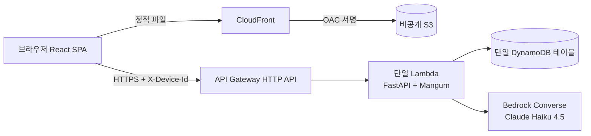
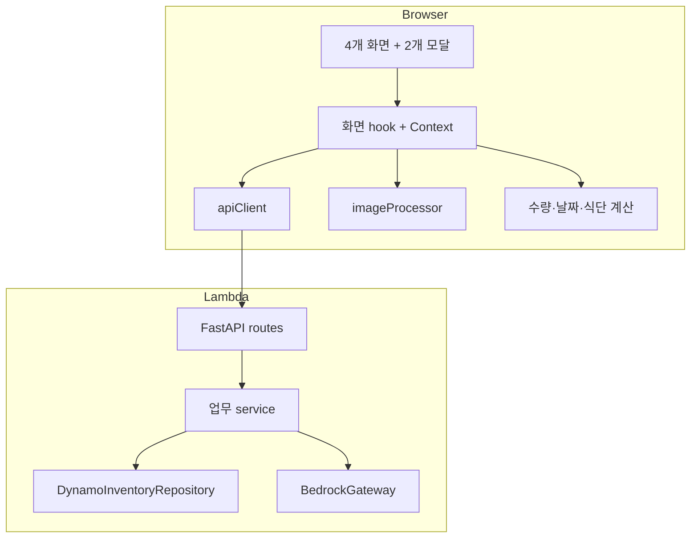
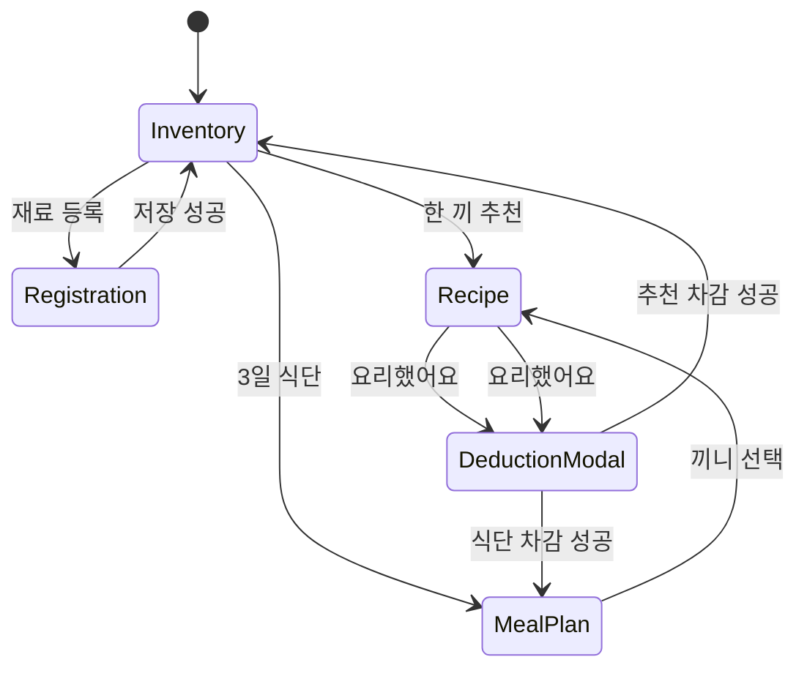
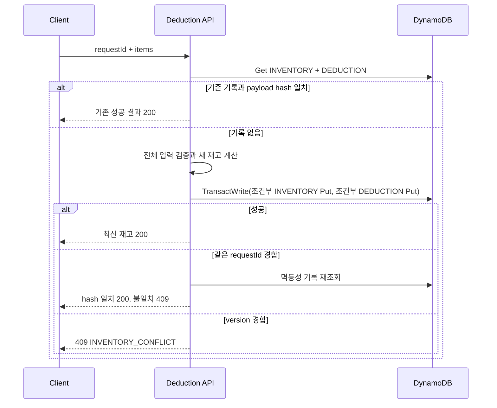

# Design Document

## Overview

`refrigerator-management-mvp`는 로그인 없는 브라우저 단위 냉장고에서 `장보기 이미지 → 인식 확인 → 재고 저장 → 임박 재료 추천 → 요리 → 확인 후 차감` 흐름을 완주하는 서버리스 SPA입니다. 1인 개발 6시간 안에 녹화 가능한 종단 간 흐름을 만드는 것을 우선하며, 별도 인증, 이벤트 처리, 백그라운드 작업, 다중 테이블, 범용 도메인 프레임워크는 추가하지 않습니다.

핵심 결정은 다음과 같습니다.

- React/Vite/TypeScript/Tailwind CSS SPA와 화면별 hook, 소수의 Context만 사용합니다.
- Python 3.13 FastAPI 애플리케이션 하나를 Mangum으로 감싸 단일 Lambda에서 모든 API를 제공합니다.
- DynamoDB에는 기기별 전체 재고 문서 한 개와 차감 멱등성 기록을 같은 파티션에 저장합니다.
- 수량은 내부에서 `halfUnits` 정수로 다룹니다. `1 halfUnit = 0.5개`이며 API 경계에서 `quantity`와 변환합니다.
- Bedrock Converse API는 요청마다 도구(tool) 하나를 강제 선택하고 JSON Schema와 Pydantic으로 결과를 검증합니다.
- 메뉴, 조리 단계, 3일 식단은 별도 요청으로 나눠 각 요청을 29초 안에 끝냅니다.
- 배포 지연 시 같은 SPA를 Vite로, 같은 FastAPI 앱을 uvicorn으로 실행하고 AWS 서비스는 `default`, `ap-northeast-2`로 호출합니다.

### 요구사항 추적 요약

| 설계 영역 | 관련 요구사항 |
| --- | --- |
| 기기 식별과 API 공통 처리 | 1, 10.8 |
| 이미지 입력, 인식, 확인 등록 | 2, 3, 4, 9.1, 9.4~9.6, 9.8 |
| 재고 조회와 편집 | 5 |
| 한 끼 추천과 레시피 | 6, 9.2, 9.10 |
| 원자 차감과 멱등성 | 7, 9.7, 9.9 |
| 3일 식단 | 8, 9.3, 9.10 |
| 공통 화면 상태와 반응형 UI | 10 |
| 런타임과 AWS 구성 | 11, 12 |
| 데모 흐름과 구현 순서 | 13 |

### 6시간 구현 배정

| 순서 | 구현 단위 | 시간 |
| --- | --- | ---: |
| 0 | SAM 뼈대와 최초 배포, 기기 ID, 데모 이미지 확인 | 40분 |
| 1 | 공통 모델, DynamoDB 저장소, 재고 API | 40분 |
| 2 | SPA 셸, 냉장고 목록, 품목 편집 | 45분 |
| 3 | 이미지 전처리, 인식, 결과 확인과 저장 | 55분 |
| 4 | 한 끼 추천과 조리 단계 | 40분 |
| 5 | 차감 확인, 원자 차감, 멱등성 | 45분 |
| 6 | 주문내역 캡처 실데이터 검증 | 15분 |
| 7 | 3일 식단과 잔여 수량 | 30분 |
| 8 | 종단 간 검증, 로컬 fallback, 리허설 | 35분 |
| **합계** |  | **345분** |

15분은 장애 대응 여유입니다. 360분을 넘길 것으로 보이면 부가 상호작용, 식단 끼니 완료 연동, 3일 식단 순서로 제외합니다. AWS 배포 문제 해결이 30분을 넘으면 로컬 종단 간 검증으로 전환합니다.

### 조사 결과와 반영

- DynamoDB `TransactWriteItems`는 원자 쓰기와 client token 멱등성을 지원하지만 token 유효 기간은 10분입니다. 시간 제한 없는 최대 1회 차감을 위해 `DEDUCTION#...` 기록을 재고 갱신과 같은 트랜잭션에 영구 저장합니다. [DynamoDB 트랜잭션 멱등성](https://docs.aws.amazon.com/amazondynamodb/latest/developerguide/transaction-apis.html#transaction-apis-txwriteitems-idempotency)
- Bedrock strict tool use는 JSON Schema로 입력을 제한할 수 있습니다. 모든 객체에 `additionalProperties: false`를 두고 서버 의미 검증을 추가합니다. [Bedrock structured outputs](https://docs.aws.amazon.com/bedrock/latest/userguide/structured-output.html#strict-tool-converse)
- 글로벌 교차 리전 추론은 요청 리전 inference profile, 요청 리전 foundation model, 글로벌 foundation model 세 리소스 권한이 필요합니다. [Bedrock global cross-Region IAM](https://docs.aws.amazon.com/bedrock/latest/userguide/global-cross-region-inference.html#global-cris-iam-setup)
- CloudFront는 원본 403/404를 `/index.html`과 200으로 바꿀 수 있습니다. SPA deep link 처리에 두 custom error response를 사용합니다. [CloudFront 응답 코드 변경](https://docs.aws.amazon.com/AmazonCloudFront/latest/DeveloperGuide/custom-error-pages-response-code.html)
- 3.75MB JPEG는 base64 변환 후 약 5MB이므로 동기 Lambda 6MB 요청 한도 안에 들어가지만 여유가 작습니다. 인식 요청에는 이미지 한 장과 multipart 메타데이터만 포함합니다.

## Architecture





서비스는 테스트 경계만 제공하는 얇은 Python 모듈입니다. 범용 DI 컨테이너, CQRS, 별도 worker는 두지 않습니다. FastAPI dependency로 DynamoDB resource와 Bedrock client를 재사용합니다.

### 화면 흐름과 상태



| 상태 | 소유 위치 | 유지 범위 |
| --- | --- | --- |
| `deviceId` | `DeviceProvider` | localStorage, 재접속 후 유지 |
| `inventory`, `lastSuccessfulInventory` | `InventoryProvider` | SPA 실행 동안, 성공 응답 때만 교체 |
| 원본/처리 이미지, 인식 초안 | `RegistrationPage` | 등록 화면 동안 |
| 추천, 조리 단계, 차감 초안 | `RecipePage` | 현재 추천/식단 끼니 흐름 동안 |
| 식단, 완료 끼니 ID 집합 | `MealPlanProvider` | 메모리만 사용, 새로고침 시 초기화 |
| 토스트 | `ToastProvider` | 표시 시간 동안 |

각 비동기 화면은 `idle | loading | success | empty | error` 상태와 요청별 `isSubmitting`을 가집니다. 실패 시 성공 데이터를 지우지 않고 오류와 재시도 동작만 추가합니다. LLM 요청 중에는 같은 요청을 막되, 메뉴를 받은 뒤 조리 단계가 로딩 중이어도 메뉴, 재료, `요리했어요`를 표시합니다.

### 29초 요청 예산

Lambda timeout은 29초, 애플리케이션 deadline은 요청 시작 후 27초입니다.

1. 헤더와 입력 검증: 목표 0.5초
2. DynamoDB 조회와 프롬프트 구성: 목표 1초
3. Bedrock 호출: Botocore `connect_timeout=2`, `read_timeout=22`, SDK 재시도 0회
4. 의미 검증과 응답 직렬화: 목표 0.5초
5. 첫 모델 결과가 의미 검증에 실패했고 8초 이상 남았을 때만 교정 요청 1회
6. 27초 deadline이면 `504 LLM_TIMEOUT`

CRUD는 Bedrock을 호출하지 않습니다. API Gateway HTTP API Lambda proxy payload format 2.0을 사용합니다.

## Components and Interfaces

### 프론트엔드 구성

```text
frontend/src/
  app/App.tsx
  api/client.ts
  models/types.ts
  logic/{quantity,date,mealPlan}.ts
  features/device/DeviceProvider.tsx
  features/inventory/{InventoryPage,ItemModal}.tsx
  features/registration/{RegistrationPage,imageProcessor}.ts(x)
  features/recipe/RecipePage.tsx
  features/deduction/DeductionModal.tsx
  features/meal-plan/{MealPlanPage,MealPlanProvider}.tsx
```

`react-router-dom`으로 `/`, `/register`, `/recipe`, `/meal-plan` 네 경로만 둡니다. 모달은 현재 페이지에서 렌더링합니다. 320~767px은 전체 폭 한 열, 768px 이상은 `max-w-[480px] mx-auto`입니다.

`DeviceProvider`는 저장 ID가 Valid_Device_ID인지 검사합니다. 없거나 잘못되면 `crypto.randomUUID()`를 생성하고 localStorage 저장 후 같은 값을 다시 읽은 뒤에만 API 영역을 렌더링합니다. 저장 실패 시 오류 화면만 표시합니다.

`apiClient`는 모든 요청에 `X-Device-Id`를 넣고 오류를 `ApiError { status, code, message, retryable }`로 정규화합니다.

### 이미지 전처리

`processImage(file)`은 다음 순서로 동작합니다.

1. MIME이 JPEG, PNG, WebP 중 하나인지 검사합니다.
2. `createImageBitmap(file, { imageOrientation: "from-image" })`으로 EXIF 방향을 반영합니다.
3. `scale = min(1, 1568 / max(width, height))`로 비율을 유지해 Canvas에 그립니다.
4. JPEG quality 0.9부터 0.1씩 낮추며 3.75MB 이하 첫 Blob을 선택합니다.
5. quality 0.5에서도 크면 긴 변을 0.85배로 줄여 다시 인코딩합니다. 긴 변 640px에서도 실패하면 전처리 오류입니다.
6. 원본 미리보기와 처리 Blob을 각각 유지해 전처리 실패와 전송 실패를 같은 이미지로 재시도합니다.

서버에는 `multipart/form-data`의 `image` 하나만 보냅니다. 서버는 `Content-Type`, JPEG magic bytes `FF D8 FF`, 실제 크기 3,932,160바이트 이하를 다시 검사하고 실패하면 Bedrock을 호출하지 않습니다.

### API 공통 계약

- Base path: `/api`
- 필수 헤더: `X-Device-Id: <UUID v4>`
- 성공: `{ "data": ..., "requestId": "..." }`
- 오류: `{ "error": { "code": "...", "message": "...", "retryable": true|false }, "requestId": "..." }`
- 날짜: 실제 달력의 `YYYY-MM-DD`
- 외부 수량: `quantity` 0.5 배수, 내부 수량: `halfUnits` 양의 정수
- Device_ID는 인증 수단이 아니라 파티션 격리 키입니다.

| Method / Path | 요청 | 성공 응답 | 주요 오류 | 요구사항 |
| --- | --- | --- | --- | --- |
| `GET /api/inventory?today=YYYY-MM-DD` | 사용자 현지 날짜 | 정렬된 재고와 `version` | 400, 500 | 1.5~1.7, 5.1 |
| `POST /api/recognitions` | multipart JPEG 한 장 | `RecognitionResultDto` | 400, 502, 504 | 2.5, 3 |
| `POST /api/inventory/items:batch` | `{expectedVersion, items[]}` | 최신 재고, 저장 수 | 400, 409, 500 | 4.8~4.14 |
| `PUT /api/inventory/items/{itemId}` | `{expectedVersion, ...item}` | 최신 재고 | 400, 404, 409, 500 | 5.7~5.14 |
| `DELETE /api/inventory/items/{itemId}?expectedVersion=n` | 헤더만 | 최신 재고 | 404, 409, 500 | 5.9~5.14 |
| `POST /api/recommendations` | `{clientDate, excludedMenuName?}` | `MealRecommendationDto` | 409, 502, 504 | 6.1~6.7, 6.12~6.13 |
| `POST /api/recipes` | `{recommendation}` | `{steps[]}` | 400, 502, 504 | 6.8~6.11 |
| `POST /api/deductions` | `{deductionRequestId, items[]}` | 최신 재고, 차감/제거 결과 | 400, 409, 500 | 7.9~7.17 |
| `POST /api/meal-plans` | `{clientDate}` | `MealPlanDto` | 409, 502, 504 | 8.1~8.8, 8.15~8.17 |

등록·편집·삭제는 마지막 성공 응답의 `expectedVersion`을 보냅니다. 버전이 다르면 `409 INVENTORY_CONFLICT`이며 최신 재고 재조회 후 다시 확인합니다. 차감은 서버가 읽은 version을 조건으로 쓰며 Deduction_Request_ID가 재시도 식별자입니다.

```ts
interface InventoryItemDto {
  id: string;
  name: string;
  quantity: number;
  storageLocation: '냉장' | '냉동' | '실온';
  expirationDate: string;
  expirationEstimated: boolean;
}
interface RecognitionResultDto {
  purchaseDate: string;
  purchaseDateSource: 'detected' | 'request_date';
  items: InventoryItemDto[];
}
interface MealIngredientDto { itemId: string; name: string; quantity: number; }
interface MealRecommendationDto {
  id: string;
  menuName: string;
  ingredients: MealIngredientDto[];
  seasonings: string[];
}
interface MealPlanDto {
  id: string;
  inventoryVersion: number;
  meals: Array<{
    id: string;
    day: 1 | 2 | 3;
    slot: '점심' | '저녁';
    recommendation: MealRecommendationDto;
  }>;
}
```

### 백엔드 구성과 업무 규칙

```text
backend/app/
  main.py
  handler.py
  config.py
  models.py
  errors.py
  routes/{inventory,recognition,recommendation,deduction,meal_plan}.py
  services/{inventory,recognition,recommendation,deduction,meal_plan}.py
  repositories/dynamodb_inventory.py
  gateways/bedrock.py
  logic/{quantity,date_rules,merge,deduction,meal_plan_summary}.py
```

- `inventory`: 정확히 같은 품목명만 병합합니다. 기존 ID와 보관 위치를 유지하고 수량을 합칩니다. 더 이른 소비기한과 그 날짜의 예상 여부를 선택하며, 날짜가 같으면 둘 중 하나라도 확정값일 때 `false`입니다.
- `recognition`: 비식품과 고정 Basic_Seasonings 8종을 제거합니다. 명시된 소비기한이 없으면 구매일과 `shelf_life_days` 사전을 사용합니다. 미등록 품목의 기본값은 냉장 5일, 냉동 30일, 실온 7일이며 `expirationEstimated=true`입니다.
- `recommendation`: 요청의 사용자 현지 `clientDate`로 만료/임박을 판정합니다. `GET /inventory`도 같은 날짜로 정렬합니다. 가장 이른 임박 품목, 없으면 가장 이른 비만료 품목을 `priorityItemId`로 프롬프트에 넣습니다.
- `deduction`: 차감 순수 함수와 DynamoDB 트랜잭션만 담당합니다.
- `meal_plan`: 정확한 6개 끼니를 검증합니다. 프론트엔드는 품목별 합계, `max(0, stock-use)` 잔여량, `max(0, use-stock)` 부족량을 계산합니다.

### Bedrock tool-use 계약

모델 ID는 `global.anthropic.claude-haiku-4-5-20251001-v1:0`입니다. 요청마다 도구 하나만 선언하고 그 도구를 강제 선택하며 모든 object에 `additionalProperties: false`를 적용합니다.

- `emit_recognition`: `purchase_date: string|null`, `items[] { name, quantity_half_units: integer>=1, storage_location: enum, detected_expiration_date: string|null, is_food, is_basic_seasoning }`
- `emit_recommendation`: `{ menu_name, ingredients[] { item_id, use_half_units: integer>=1 }, seasonings[] }`
- `emit_recipe`: `{ ingredient_names: string[], steps: string[1..8] }`
- `emit_meal_plan`: `{ meals: 정확히 6개 [{ day: 1..3, slot: 점심|저녁, menu_name, ingredients[], seasonings[] }] }`

Pydantic 의미 검증은 item ID 존재, 비만료 여부, 한 끼 사용량 1~현재 halfUnits, 추천의 priority item 포함, 재고 최소 한 개 사용, 조리 단계의 `ingredient_names`가 추천 품목명과 Basic_Seasonings 안에 있는지, 식단 day/slot 순서와 각 끼니 직전 예상 잔여량 기준 priority item 사용을 검사합니다. `ingredient_names`는 검증에만 사용하고 API 응답에서는 제외합니다. 검증 실패 시 시간이 8초 이상 남았을 때만 교정 1회를 수행하고 다시 실패하면 502입니다.

### 재고 원자 차감과 멱등성



payload hash는 item ID와 `useHalfUnits`를 item ID순으로 정렬한 canonical JSON의 SHA-256입니다. 같은 ID와 다른 hash면 `409 IDEMPOTENCY_KEY_REUSED`입니다. 트랜잭션은 다음 두 작업을 전부 성공하거나 전부 실패시킵니다.

1. `PK=DEVICE#<id>, SK=INVENTORY`를 `version = readVersion` 조건으로 전체 교체
2. `PK=DEVICE#<id>, SK=DEDUCTION#<requestId>`를 `attribute_not_exists(PK)` 조건으로 생성

기록에는 hash, 차감 수, 제거 이름, 결과 version, 생성 시각을 저장하고 TTL을 두지 않습니다. 잘못된 품목이나 수량, 재고 초과가 하나라도 있으면 트랜잭션 전에 오류를 반환합니다. 초안 수정 시 새 Deduction_Request_ID를 만들고, 전송 후 timeout/네트워크 실패 재시도는 기존 ID를 유지합니다.

## Data Models

### DynamoDB 단일 테이블

테이블은 `PAY_PER_REQUEST`, 키는 String `pk`와 `sk`입니다. 실제 이름은 SAM이 만들고 `TABLE_NAME` 환경 변수로 전달합니다.

| 레코드 | PK | SK | 주요 속성 |
| --- | --- | --- | --- |
| 기기 재고 | `DEVICE#<uuid>` | `INVENTORY` | `version`, `items` Map, `updatedAt` |
| 차감 기록 | `DEVICE#<uuid>` | `DEDUCTION#<requestId>` | `payloadHash`, `deductedCount`, `removedNames`, `resultVersion`, `createdAt` |

```json
{
  "id": "item-uuid",
  "name": "양파",
  "quantityHalfUnits": 16,
  "storageLocation": "실온",
  "expirationDate": "2026-04-12",
  "expirationEstimated": true,
  "createdAt": "2026-04-07T10:00:00Z",
  "updatedAt": "2026-04-07T10:00:00Z"
}
```

기기별 문서 하나는 조회 1회와 단순한 조건부 전체 교체를 가능하게 합니다. DynamoDB 항목 크기 안에서 동작하도록 기기당 최대 200개 품목, 이름 최대 80자로 제한합니다. 향후 품목별 레코드 전환은 MVP 밖입니다.

### 도메인 불변식

- 수량 halfUnits는 1 이상의 정수이며 `quantity = halfUnits / 2`입니다.
- Storage_Location은 `냉장 | 냉동 | 실온`입니다.
- 소비기한은 실제 ISO 달력 날짜입니다.
- Basic_Seasonings는 재고와 차감 항목에 저장하지 않습니다.
- item ID와 품목명은 기기 재고 안에서 각각 유일합니다.
- 성공한 변경마다 재고 `version`이 정확히 1 증가합니다.
- 차감 후 양수 항목만 남고 0인 항목은 제거됩니다.
- 한 Deduction_Request_ID는 한 payload hash와 최대 한 번의 version 증가에만 대응합니다.

### 프론트엔드 파생 모델

- `calendarDateDifference`는 사용자 기기 현지 달력 날짜 ordinal 차입니다.
- 정렬 키는 `[expired ? 0 : 1, expirationDate, name, id]`입니다.
- 차이가 양수면 `D-n`, 0이면 `D-day`, 음수면 `지남`, 0~3이면 `임박`입니다.
- `DeductionPreview.afterHalfUnits = currentHalfUnits - useHalfUnits`입니다.
- 식단 요약은 생성 시점 snapshot과 6개 끼니를 기준으로 하며 실제 차감 뒤에도 `식단을 짠 시점의 재고 기준`을 표시합니다.

## Correctness Properties

*A property is a characteristic or behavior that should hold true across all valid executions of a system-essentially, a formal statement about what the system should do. Properties serve as the bridge between human-readable specifications and machine-verifiable correctness guarantees.*

### Property 1: 기기 식별과 요청 라우팅

*For all* localStorage 초기 상태와 API 요청에 대해, 저장 ID가 없으면 생성 ID는 UUID v4이고, 저장 성공 뒤 모든 요청은 같은 ID를 `X-Device-Id`로 보내며, 서로 다른 유효 ID의 저장소 key는 다릅니다.

**Validates: Requirements 1.1, 1.3, 1.5**

### Property 2: 유효하지 않은 기기 헤더의 무부작용

*For all* 누락, 빈 값 또는 UUID v4가 아닌 기기 헤더에 대해, 변경 API는 400을 반환하고 저장소 write를 호출하지 않습니다.

**Validates: Requirements 1.6, 1.7**

### Property 3: 이미지 기하 보존

*For all* 양의 이미지 너비와 높이에 대해, resize 결과는 긴 변이 1568 이하이고 원본 종횡비와 방향을 허용 오차 안에서 보존합니다.

**Validates: Requirements 2.2, 2.3**

### Property 4: 지원하지 않는 이미지의 무요청 처리

*For all* JPEG, PNG, WebP가 아닌 MIME에 대해, 클라이언트는 인식 API를 호출하지 않고 지원 형식 오류를 만듭니다.

**Validates: Requirements 2.6**

### Property 5: 반 개 단위 변환

*For all* 양의 측정량과 판매 단위에 대해, Half_Unit_Rounding 결과는 가장 가까운 0.5개 배수이고 정확한 중간값에서는 큰 쪽입니다.

**Validates: Requirements 3.4**

### Property 6: 인식 결과 정규화

*For all* 유효한 Bedrock 도구 결과에 대해, 정규화 항목은 필수 필드와 양의 정수 halfUnits를 가지며 비식품과 Basic_Seasonings는 존재하지 않습니다.

**Validates: Requirements 3.3, 3.9**

### Property 7: 소비기한 추정

*For all* 요청 날짜, 선택적 인식 구매일, 품목과 보관 기간에 대해, 기준일은 인식 구매일이 있으면 그 날짜이고 없으면 요청 날짜이며, 추정 소비기한은 기준일+보관 기간이고 예상 여부는 true입니다.

**Validates: Requirements 3.5, 3.6, 3.7, 3.8**

### Property 8: 서버 이미지 경계

*For all* 바이트열과 크기에 대해, JPEG signature이고 3.75MB 이하일 때만 Bedrock 호출을 허용하며 그 외에는 400과 Bedrock 호출 0회를 보장합니다.

**Validates: Requirements 3.10, 3.11**

### Property 9: 동일 이름 병합 보존

*For all* 유효한 기존/신규 목록에 대해, 정확히 같은 이름은 하나가 되고 이름별 총수량은 보존되며 소비기한은 최솟값입니다. 예상 여부는 최솟값 원본을 따르고 날짜가 같으면 두 boolean의 논리 AND입니다.

**Validates: Requirements 4.9, 4.10, 4.11, 4.12**

### Property 10: 수정 입력 검증

*For all* 품목 입력에 대해, 수량이 0.5 이상인 0.5 배수이고 이름이 비어 있지 않으며 보관 위치와 실제 ISO 날짜가 유효할 때만 저장 또는 차감 요청을 만들 수 있습니다.

**Validates: Requirements 4.5, 4.6, 5.7, 7.3, 9.4, 9.5, 9.6**

### Property 11: 정렬과 날짜 표시

*For all* 재고 목록과 현지 기준일에 대해, 지난 품목이 먼저이고 각 그룹 날짜가 비감소하며, 날짜 차이가 음수면 `지남`, 0이면 `D-day`, 양수면 `D-n`, 0~3이면 `임박`입니다.

**Validates: Requirements 5.1, 5.2, 5.5, 5.6**

### Property 12: 실패 시 상태 보존

*For all* 마지막 성공 재고와 입력 초안에 대해, 조회·저장·편집·삭제·인식·추천·조리 단계·차감 실패는 마지막 성공 재고와 재시도 입력을 바꾸지 않습니다.

**Validates: Requirements 5.13, 5.14, 6.11, 6.13, 7.16, 10.4, 10.8, 13.12**

### Property 13: 추천 우선 품목

*For all* 비어 있지 않은 재고에 대해, 임박 품목이 있으면 priority item은 그중 가장 이른 품목이고 없으면 비만료 품목 중 가장 이른 품목입니다.

**Validates: Requirements 6.1, 6.2**

### Property 14: 추천과 조리 단계 유효성

*For all* 승인된 추천과 조리 단계에 대해, 추천은 priority item을 포함한 비만료 재고를 최소 하나 사용하고 사용량은 1~현재 halfUnits이며, 모든 재료는 비만료 재고와 Basic_Seasonings의 합집합에 포함됩니다.

**Validates: Requirements 6.3, 6.4, 6.5, 6.6, 6.9**

### Property 15: 다른 메뉴 제외

*For all* 직전 메뉴 이름에 대해, 다른 메뉴 요청에서 승인되는 새 메뉴 이름은 직전 이름과 다릅니다.

**Validates: Requirements 6.12**

### Property 16: 차감 초안과 요청 투영

*For all* 유효한 추천에 대해, 최초 초안은 추천 재고 품목을 같은 사용량으로 모두 포함하고, 확정 요청은 포함된 품목과 확정 수량만 Deduction_Request_ID와 함께 전달합니다.

**Validates: Requirements 7.1, 7.9, 9.7**

### Property 17: 차감 산술과 제거

*For all* 현재 수량과 그 이하인 양의 사용 halfUnits에 대해, 결과는 현재-사용이며 0이면 품목이 제거되고 양수면 그 값으로 한 번만 존재합니다.

**Validates: Requirements 7.3, 7.5, 7.11**

### Property 18: 차감 멱등성

*For all* 유효한 재고, Deduction_Request_ID와 payload에 대해, 같은 ID와 payload를 여러 번 처리한 결과와 version은 한 번 처리한 결과와 같고, 같은 ID의 다른 payload는 재고를 바꾸지 않고 충돌을 반환합니다.

**Validates: Requirements 7.10, 7.12, 7.15**

### Property 19: 식단 구조와 재료 제한

*For all* 승인된 식단에 대해, 끼니는 `(1,점심)`부터 `(3,저녁)`까지 정확히 6개 순서이며 모든 재료는 생성 시점 비만료 재고와 Basic_Seasonings 안에 있습니다.

**Validates: Requirements 8.1, 8.4, 8.5**

### Property 20: 식단 순차 우선 소비

*For all* 재고 snapshot과 승인된 식단에 대해, 각 끼니 직전 잔여 재고에서 임박 항목이 있으면 가장 이른 임박 항목을 우선 줄이고 없으면 가장 이른 비만료 항목을 우선 줄입니다.

**Validates: Requirements 8.2, 8.3**

### Property 21: 식단 잔여량과 부족량

*For all* 0 이상 재고 halfUnits와 사용량 합계에 대해, 잔여량은 `max(0, stock-use)`, 부족량은 `max(0, use-stock)`이며 둘 중 최대 하나만 양수입니다.

**Validates: Requirements 8.7, 8.8**

### Property 22: 완료 끼니 전이

*For all* 식단과 끼니 ID에 대해, 차감 성공은 해당 ID만 완료 집합에 추가하고 실패나 취소는 기존 집합을 바꾸지 않습니다.

**Validates: Requirements 8.10, 8.11**

### Property 23: 차감 전후 표시

*For all* 유효한 품목명과 현재/차감 후 수량에 대해, formatter는 `<품목명> <현재>개 → <차감 후>개` 순서로 값을 손실 없이 포함합니다.

**Validates: Requirements 7.6, 13.5**

## Error Handling

| HTTP | 코드 | 사용자 처리 | 서버 상태 |
| ---: | --- | --- | --- |
| 400 | `INVALID_DEVICE_ID`, `INVALID_IMAGE`, `VALIDATION_ERROR` | 입력 수정/다른 이미지 | write 없음 |
| 404 | `ITEM_NOT_FOUND` | 최신 재고 재조회 | write 없음 |
| 409 | `INVENTORY_CONFLICT` | 재조회 후 재확인 | 조건부 write 실패 |
| 409 | `NO_USABLE_ITEMS` | 사용 가능 재료 없음 표시 | write 없음 |
| 409 | `IDEMPOTENCY_KEY_REUSED` | 새 사용자 동작에서 새 ID | write 없음 |
| 502 | `RECOGNITION_FAILED`, `GENERATION_FAILED`, `INVALID_MODEL_OUTPUT` | 같은 입력 재시도 | 재고 불변 |
| 504 | `LLM_TIMEOUT` | 같은 입력 재시도 | 재고 불변 |
| 500 | `STORAGE_ERROR`, `INTERNAL_ERROR` | 입력 유지 후 재시도 | 트랜잭션 실패 시 불변 |

클라이언트 복구 규칙은 다음과 같습니다.

- 인식 실패는 Shopping_Image와 Processed_Image를 유지하고 같은 이미지, 다른 이미지, 직접 입력을 제공합니다.
- 저장 실패는 인식/편집 초안을 유지합니다.
- 추천 실패는 현재 냉장고를 유지합니다.
- 조리 단계 실패는 추천을 유지하고 조리 단계만 재시도합니다.
- 차감 실패는 draft와 Deduction_Request_ID를 유지합니다. timeout 재시도도 같은 ID입니다.
- 식단의 `NO_USABLE_ITEMS`와 생성 실패를 다른 상태로 표시합니다.
- 성공 응답 전에는 `lastSuccessfulInventory`를 교체하지 않습니다.

Pydantic 오류는 안전한 한국어 메시지로 변환합니다. 로그에는 `requestId`, route, duration, error code만 JSON으로 기록하고 이미지, 프롬프트 전문, Device_ID 전체, 재고 내용은 기록하지 않습니다.

## Testing Strategy

수량 변환, 날짜 분류, 병합, 후보 선택, 차감, 식단 집계는 입력 공간이 넓은 순수 로직이므로 PBT가 적합합니다. UI 렌더링, IaC, DynamoDB/Bedrock 연동은 예제, schema assertion, 통합 테스트로 검증합니다.

### 도구와 PBT 설정

- 프론트엔드: Vitest, React Testing Library, user-event, `fast-check`
- 백엔드: pytest, FastAPI TestClient, Hypothesis, Botocore Stubber
- IaC: `sam validate`, `sam build`, template YAML assertion

각 property는 정확히 하나의 property test로 구현하고 최소 100회 실행합니다. `fast-check`는 `{ numRuns: 100 }`, Hypothesis는 `@settings(max_examples=100)` 이상입니다. 테스트 주석은 `Feature: refrigerator-management-mvp, Property {번호}: {속성 문장}` 형식입니다.

| Property | 위치 | 주 생성 데이터 |
| --- | --- | --- |
| 1~4, 11~12, 16, 21~23 | TypeScript | UUID/state, 이미지 치수, 날짜, 재고, 식단 합계 |
| 5~10, 13~15, 17~20 | Python | 측정량, 날짜, tool output, 추천, 차감, 식단 |

Property 18은 AWS를 100회 호출하지 않고 인메모리 원자 저장소 모델로 PBT합니다. 실제 DynamoDB는 성공, 중복, 조건 충돌 대표 3건만 통합 테스트합니다.

### 예제와 통합 테스트

- localStorage 실패, 단일 업로드 문구, 빈 인식 결과, 처리 중 버튼 잠금, 재시도 상태
- 인식값 수정/추가/삭제, 소비기한 수정 시 `예상` 제거
- 빈 냉장고, 예상/임박/지남 배지, 320/767/768px UI 확인
- 조리 단계 pending/실패 중 추천과 `요리했어요` 유지
- 차감 전체 해제, 품목 추가 기본 1개, 취소 무요청, 같은 ID 재시도
- 식단 route 왕복 유지와 Provider remount 초기화
- 사용자 표시 문자열에 `유통기한`이 없는지 정적 검사
- 기기 ID 격리, batch rollback, version 충돌, 원자 차감과 멱등성
- Bedrock 네 tool schema/강제 선택, 유효·무효 결과, timeout mapping
- CORS preflight 두 origin과 `Content-Type`, `X-Device-Id`
- OAC bucket policy와 CloudFront 403/404 fallback template assertion

종단 간 승인은 영수증 등록, 주문 캡처 등록, 임박 추천과 조리/차감, 같은 차감 ID 재전송, 6개 끼니 식단, Bedrock 오류 복구 순으로 진행합니다.

### SAM 배포 구조

`template.yaml`에는 다음 리소스만 둡니다.

- `StaticBucket`: encryption, PublicAccessBlock을 적용한 비공개 S3
- `StaticOriginAccessControl`: SigV4 OAC
- `StaticBucketPolicy`: CloudFront service principal과 distribution `AWS:SourceArn`만 허용
- `WebDistribution`: `DefaultRootObject=index.html`, HTTPS redirect, 압축, 403/404 → `/index.html` 200
- `HttpApi`: payload 2.0, CloudFront 도메인과 `http://localhost:5173` CORS
- `ApiFunction`: Python 3.13, 1024MB, timeout 29초, Mangum handler
- `InventoryTable`: `pk`/`sk`, `PAY_PER_REQUEST`

Lambda IAM은 해당 table ARN의 `GetItem`, `PutItem`, `TransactWriteItems`와 다음 세 ARN의 `bedrock:InvokeModel`만 허용합니다.

```text
arn:aws:bedrock:ap-northeast-2:${AWS::AccountId}:inference-profile/global.anthropic.claude-haiku-4-5-20251001-v1:0
arn:aws:bedrock:ap-northeast-2::foundation-model/anthropic.claude-haiku-4-5-20251001-v1:0
arn:aws:bedrock:::foundation-model/anthropic.claude-haiku-4-5-20251001-v1:0
```

환경 변수는 `TABLE_NAME`, `MODEL_ID`, `APP_ENV`, `CORS_ORIGINS`입니다. Outputs는 `WebUrl`, `ApiUrl`, `StaticBucketName`, `DistributionId`입니다.

```bash
sam validate --profile default --region ap-northeast-2
sam build --profile default --region ap-northeast-2
sam deploy --guided --profile default --region ap-northeast-2
npm --prefix frontend run build
aws s3 sync frontend/dist "s3://<StaticBucketName>" --delete --profile default --region ap-northeast-2
aws cloudfront create-invalidation --distribution-id "<DistributionId>" --paths "/*" --profile default --region ap-northeast-2
```

`sync --delete`는 대상 bucket을 확인한 뒤 실행합니다.

### 로컬 fallback

배포 문제 시 별도 구현 없이 동일 산출물을 실행합니다. 로컬 FastAPI는 배포된 DynamoDB와 Bedrock을 사용합니다. `.env.dev`에는 리소스 이름과 API URL만 두고 비밀값은 저장하지 않습니다.

```bash
# 터미널 1
AWS_PROFILE=default AWS_REGION=ap-northeast-2 uvicorn app.main:app --app-dir backend --port 8000

# 터미널 2
VITE_API_BASE_URL=http://localhost:8000 npm --prefix frontend run dev
```

개발 서버는 자동 테스트에서 시작하지 않으며 사용자가 각 터미널에서 직접 실행합니다.
