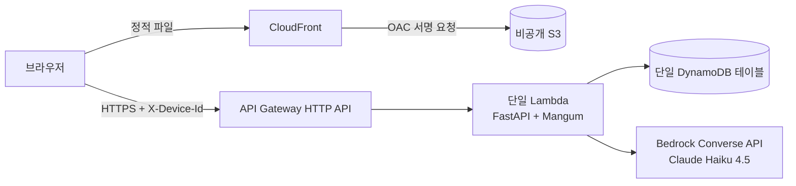
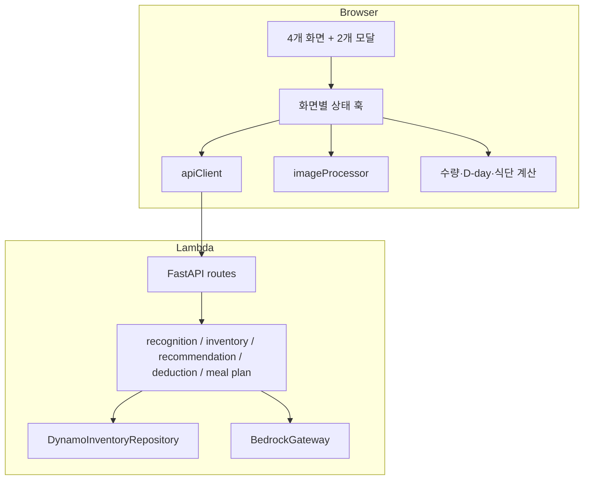
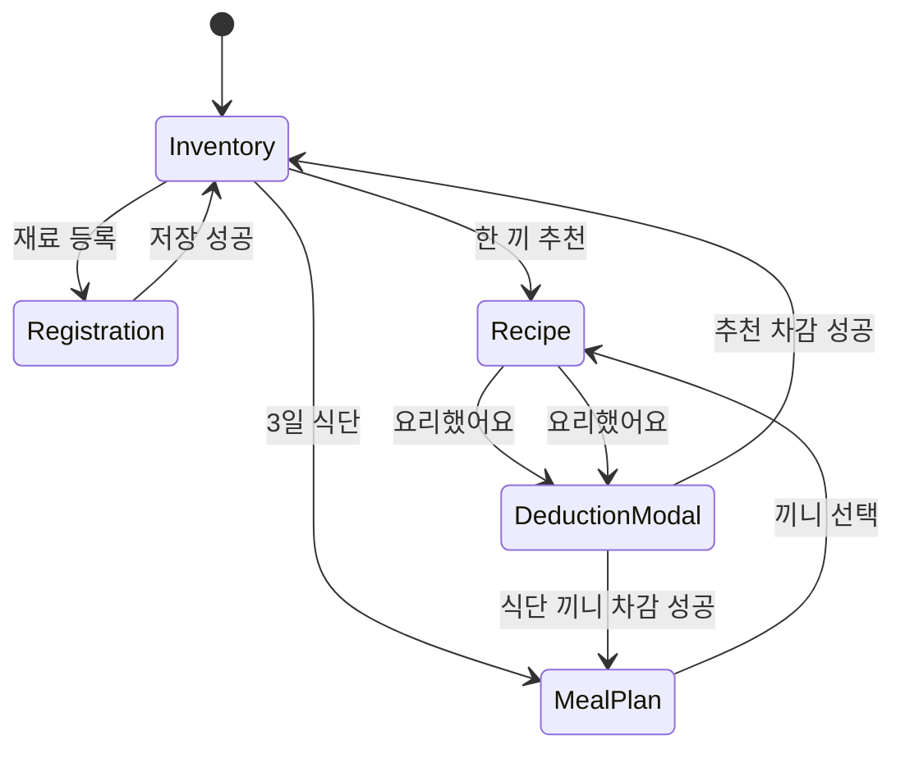
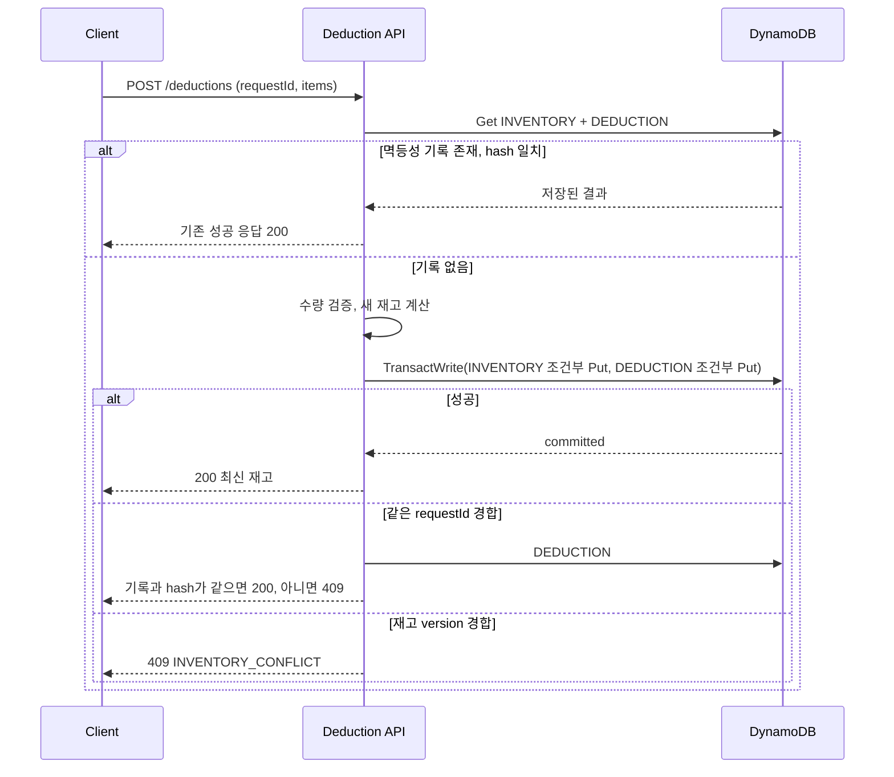

# Design Document

## Overview

`refrigerator-management-mvp`는 로그인 없는 브라우저 단위 냉장고에서 `장보기 이미지 → 인식 결과 확인 → 재고 저장 → 임박 재료 추천 → 요리 → 확인 후 원자 차감` 흐름을 완주하는 서버리스 단일 페이지 애플리케이션입니다. 설계는 1인 개발 6시간 안에 한 데모 흐름을 안정적으로 구현하는 것을 우선하며, 별도 인증, 이벤트 처리, 백그라운드 작업, 다중 테이블 및 범용 도메인 프레임워크를 추가하지 않습니다.

핵심 설계 결정은 다음과 같습니다.

- 프론트엔드는 React/Vite/TypeScript/Tailwind CSS SPA 하나이며, 화면 상태는 React Context와 화면별 훅으로 관리합니다. 별도 전역 상태 라이브러리는 쓰지 않습니다.
- 백엔드는 Python 3.13 FastAPI 애플리케이션 하나를 Mangum으로 감싼 단일 Lambda입니다.
- DynamoDB에는 기기별 전체 재고 문서 한 개와 차감 멱등성 기록을 같은 파티션에 저장합니다. 전체 재고 문서 교체와 멱등성 기록 생성을 한 트랜잭션으로 묶어 부분 차감을 막습니다.
- 수량은 프론트엔드와 백엔드 내부에서 `halfUnits` 정수로 다룹니다. `1 halfUnit = 0.5개`이며 API 경계에서 사용자 표시용 `quantity`와 상호 변환합니다. 부동소수점 오차를 차감 로직에서 제거하기 위한 결정입니다.
- Bedrock 응답은 Converse API의 강제 도구 선택(tool choice)과 엄격한 JSON 입력 스키마로 구조를 제한하고, 애플리케이션 검증을 통과한 결과만 반환합니다.
- 각 LLM API 호출은 단일 생성 작업만 수행합니다. 메뉴와 사용 재료, 조리 단계, 3일 식단을 분리하여 29초 제한 안에 반환합니다.
- 배포가 지연되면 같은 FastAPI 앱을 uvicorn으로, 같은 SPA를 Vite로 실행합니다. 로컬 백엔드도 `default` 프로파일과 `ap-northeast-2`를 사용하여 DynamoDB와 Bedrock을 호출합니다.

### 요구사항 추적 요약

| 설계 영역                    | 관련 요구사항              |
| ---------------------------- | -------------------------- |
| 기기 식별, API 공통 처리     | 1, 10.8                    |
| 이미지 입력, 인식, 확인 등록 | 2, 3, 4, 9.1, 9.4~9.6, 9.8 |
| 재고 조회와 편집             | 5                          |
| 한 끼 추천과 레시피          | 6, 9.2, 9.10               |
| 원자 차감과 멱등성           | 7, 9.7, 9.9                |
| 3일 식단                     | 8, 9.3, 9.10               |
| 화면 상태와 반응형 UI        | 10                         |
| 런타임과 AWS 구성            | 11, 12                     |
| 데모 흐름과 구현 순서        | 13                         |

### 6시간 구현 배정

| 순서     | 구현 단위                                            |      시간 |
| -------- | ---------------------------------------------------- | --------: |
| 0        | SAM 뼈대와 최초 배포, 기기 ID, 데모 이미지 사전 확인 |      40분 |
| 1        | 공통 모델, DynamoDB 저장소, 재고 API                 |      40분 |
| 2        | SPA 셸, 냉장고 목록, 품목 편집                       |      45분 |
| 3        | 이미지 전처리, 인식 API, 결과 확인과 저장            |      55분 |
| 4        | 한 끼 추천과 조리 단계                               |      40분 |
| 5        | 차감 확인, 원자 차감, 멱등성                         |      45분 |
| 6        | 주문내역 캡처 실데이터 검증과 보정                   |      15분 |
| 7        | 3일 식단과 잔여 수량                                 |      30분 |
| 8        | 종단 간 검증, 로컬 fallback, 데모 리허설             |      35분 |
| **합계** |                                                      | **345분** |

15분은 장애 대응 여유입니다. 360분을 넘길 것으로 보이면 부가 상호작용, 식단 끼니 완료 연동, 3일 식단 순서로 제외합니다. AWS 배포 문제 해결이 30분을 넘으면 로컬 종단 간 검증으로 즉시 전환합니다.

### 조사 결과와 설계 반영

- DynamoDB `TransactWriteItems`는 모든 작업을 전부 성공하거나 전부 실패시키며 클라이언트 토큰을 통한 멱등성을 지원하지만, 토큰 유효 기간은 10분입니다. 요구사항의 시간 제한 없는 최대 1회 적용을 만족하기 위해 별도 `DEDUCTION#...` 기록을 재고 갱신과 같은 트랜잭션에 영구 저장합니다. [DynamoDB 트랜잭션 멱등성](https://docs.aws.amazon.com/amazondynamodb/latest/developerguide/transaction-apis.html#transaction-apis-txwriteitems-idempotency)
- Bedrock Converse의 strict tool use는 JSON Schema로 도구 입력을 제한할 수 있습니다. 모든 객체는 `additionalProperties: false`로 닫고 백엔드 Pydantic 검증을 추가합니다. [Bedrock structured outputs](https://docs.aws.amazon.com/bedrock/latest/userguide/structured-output.html#strict-tool-converse)
- 글로벌 교차 리전 추론은 요청 리전의 inference profile, 요청 리전 foundation model, 글로벌 foundation model의 세 리소스 권한이 필요합니다. SAM 역할에 이 세 ARN만 허용합니다. [Bedrock global cross-Region IAM](https://docs.aws.amazon.com/bedrock/latest/userguide/global-cross-region-inference.html#global-cris-iam-setup)
- CloudFront는 원본의 403/404를 `/index.html`과 200으로 치환할 수 있습니다. SPA deep link 처리에 두 사용자 지정 오류 응답을 사용합니다. [CloudFront 응답 코드 변경](https://docs.aws.amazon.com/AmazonCloudFront/latest/DeveloperGuide/custom-error-pages-response-code.html)
- 동기 Lambda 요청의 6MB 제한을 고려하면 3.75MB JPEG는 base64 인코딩 후 약 5MB가 됩니다. API 요청은 이미지 한 장만 포함하고 추가 메타데이터를 작게 유지합니다.

## Architecture



### 런타임 계층



서비스 클래스는 테스트 경계만 제공하는 얇은 Python 모듈입니다. 범용 DI 컨테이너나 CQRS 계층은 두지 않습니다. FastAPI dependency로 DynamoDB 리소스와 Bedrock 클라이언트만 재사용합니다.

### 화면 흐름과 상태 소유권



| 상태                                   | 소유 위치           | 유지 범위                               |
| -------------------------------------- | ------------------- | --------------------------------------- |
| `deviceId`                             | `DeviceProvider`    | localStorage, 브라우저 재접속 후 유지   |
| `inventory`, `lastSuccessfulInventory` | `InventoryProvider` | SPA 실행 동안 유지, 성공 응답 때만 교체 |
| 선택 이미지, 처리 이미지, 인식 초안    | `RegistrationPage`  | 페이지를 나가면 폐기                    |
| 추천, 조리 단계, 차감 초안             | `RecipePage`        | 추천/식단 끼니 흐름 동안 유지           |
| 식단, 완료 끼니 ID 집합                | `MealPlanProvider`  | 메모리만 사용, 새로고침 시 초기화       |
| 토스트                                 | `ToastProvider`     | 메시지 표시 시간 동안 유지              |

각 비동기 화면은 `idle | loading | success | empty | error` 판별 가능한 상태와 요청 종류별 `isSubmitting`을 가집니다. 실패 시 성공 데이터를 지우지 않고 오류와 재시도 함수만 추가합니다. LLM 요청 중에는 같은 요청과 파일 재선택을 막되, 이미 받은 메뉴는 조리 단계 로딩 중에도 표시합니다.

### 요청 처리와 29초 예산

Lambda timeout은 29초로 설정하고 애플리케이션 deadline은 요청 시작 후 27초로 둡니다.

1. 헤더와 요청 본문 검증: 목표 0.5초 이내
2. DynamoDB 조회와 프롬프트 구성: 목표 1초 이내
3. Bedrock 호출: Botocore `connect_timeout=2`, `read_timeout=22`, SDK 재시도 0회
4. 의미 검증: 목표 0.5초 이내
5. 첫 응답이 스키마 의미 검증에 실패했고 deadline까지 8초 이상 남았을 때만 교정 프롬프트로 1회 재호출
6. 27초 deadline 도달 시 `504 LLM_TIMEOUT` 반환

일반 CRUD는 Bedrock을 호출하지 않습니다. API Gateway HTTP API의 Lambda proxy payload format 2.0을 사용하며 모든 성공/오류 응답은 29초 전에 반환하도록 합니다.

## Components and Interfaces

### 프론트엔드 구성

```text
frontend/src/
  app/App.tsx
  api/client.ts
  models/types.ts
  logic/quantity.ts
  logic/date.ts
  logic/mealPlan.ts
  features/device/DeviceProvider.tsx
  features/inventory/InventoryPage.tsx
  features/inventory/ItemModal.tsx
  features/registration/RegistrationPage.tsx
  features/registration/imageProcessor.ts
  features/recipe/RecipePage.tsx
  features/deduction/DeductionModal.tsx
  features/meal-plan/MealPlanPage.tsx
```

라우팅은 `react-router-dom`의 `/`, `/register`, `/recipe`, `/meal-plan` 네 경로만 사용합니다. 모달은 현재 페이지 상태로 렌더링합니다. 320~767px에서는 전체 폭 한 열, 768px 이상에서는 `max-w-[480px] mx-auto`를 적용합니다.

`DeviceProvider`는 UUID v4 정규식으로 기존 값을 검사하고 없거나 잘못된 값이면 `crypto.randomUUID()`로 다시 생성합니다. localStorage 저장 후 재조회하여 같은 값인지 확인하기 전에는 앱의 API 영역을 렌더링하지 않습니다. 저장 실패 시 오류 화면만 표시합니다.

`apiClient`는 모든 요청에 `X-Device-Id`를 넣고 `ApiError { status, code, message, retryable }`로 오류를 정규화합니다. 서버 상태를 바꾸는 요청에는 버튼 중복 클릭 방지와 별개로 백엔드 조건부 쓰기를 적용합니다.

### 이미지 전처리

`processImage(file)`의 절차는 다음과 같습니다.

1. MIME이 `image/jpeg`, `image/png`, `image/webp` 중 하나인지 검사합니다.
2. `createImageBitmap(file, { imageOrientation: "from-image" })`으로 EXIF 방향을 반영해 디코딩합니다.
3. `scale = min(1, 1568 / max(width, height))`로 계산하고 Canvas에 비율을 유지해 그립니다.
4. JPEG quality 0.9부터 0.1씩 낮추어 Blob을 만들고 3.75MB 이하가 되는 첫 결과를 사용합니다.
5. quality 0.5에서도 제한을 넘으면 긴 변을 0.85배씩 줄여 다시 인코딩합니다. 최소 긴 변 640px에서도 실패하면 전처리 오류를 반환합니다.
6. 결과 Blob과 원본 미리보기 URL을 페이지 상태에 보관합니다. 실패나 네트워크 오류가 나도 원본/처리 이미지를 각각 유지해 같은 이미지로 재시도합니다.

Canvas는 항상 JPEG Blob을 생성하므로 서버에는 `multipart/form-data`의 `image` 필드 하나만 전송됩니다. 서버는 magic bytes `FF D8 FF`, 실제 본문 크기 3,932,160바이트 이하를 다시 검사합니다.

### API 공통 계약

- Base path: `/api`
- 공통 요청 헤더: `X-Device-Id: <UUID v4>`
- JSON 응답 성공: `{ "data": ..., "requestId": "..." }`
- 오류: `{ "error": { "code": "...", "message": "...", "retryable": true|false }, "requestId": "..." }`
- 날짜: `YYYY-MM-DD`
- 수량: 외부 계약은 `quantity` 숫자이며 0.5 배수, 내부 모델은 `halfUnits` 양의 정수
- `Device_ID`는 인증 수단이 아니며 파티션 격리 키로만 사용합니다.

| Method / Path | 요청 | 성공 응답 | 주요 오류 | 요구사항 |
| --- | --- | --- | --- | --- |
| `GET /api/inventory?today=YYYY-MM-DD` | 헤더와 사용자 현지 날짜 | `InventoryItemDto[]` 정렬 목록 | 400, 500 | 1.5~1.7, 5.1 |
| `POST /api/recognitions` | multipart JPEG 한 장 | `RecognitionResultDto` | 400 `INVALID_IMAGE`, 504, 502 `RECOGNITION_FAILED` | 2.5, 3 |
| `POST /api/inventory/items:batch` | `{expectedVersion, items[]}` | 최신 재고, 저장 품목 수 | 400, 409, 500 | 4.8~4.14 |
| `PUT /api/inventory/items/{itemId}` | `{expectedVersion, ...품목 필드}` | 최신 재고 | 400, 404, 409, 500 | 5.7~5.14 |
| `DELETE /api/inventory/items/{itemId}?expectedVersion=n` | 헤더만 | 최신 재고 | 404, 409, 500 | 5.9~5.14 |
| `POST /api/recommendations` | `{clientDate, excludedMenuName?}` | `MealRecommendationDto` | 409 `NO_USABLE_ITEMS`, 504, 502 | 6.1~6.7, 6.12~6.13 |
| `POST /api/recipes` | `{recommendation}` | `{steps: string[]}` | 400, 504, 502 | 6.8~6.11 |
| `POST /api/deductions` | `{deductionRequestId, items[]}` | 최신 재고, 차감 품목 수, 제거 품목명 | 400, 409, 500 | 7.9~7.17 |
| `POST /api/meal-plans` | `{clientDate}` | `MealPlanDto` | 409 `NO_USABLE_ITEMS`, 504, 502 | 8.1~8.8, 8.15~8.17 |

모든 변경 API는 현재 재고 문서의 `version`을 응답합니다. 편집/삭제/일괄 등록 요청은 클라이언트가 마지막으로 본 `expectedVersion`을 보냅니다. 버전이 다르면 `409 INVENTORY_CONFLICT`를 반환하고 최신 목록 재조회 동작을 제공합니다. 차감은 `Deduction_Request_ID`가 재시도 식별자이므로 별도 `expectedVersion`을 받지 않지만, 서버 내부에서 읽은 버전을 조건으로 트랜잭션을 수행합니다.

### 주요 DTO

```ts
interface InventoryItemDto {
  id: string;
  name: string;
  quantity: number; // 0.5 배수
  storageLocation: "냉장" | "냉동" | "실온";
  expirationDate: string;
  expirationEstimated: boolean;
}

interface RecognitionResultDto {
  purchaseDate: string;
  purchaseDateSource: "detected" | "request_date";
  items: InventoryItemDto[];
}

interface MealIngredientDto {
  itemId: string;
  name: string;
  quantity: number;
}

interface MealRecommendationDto {
  id: string;
  menuName: string;
  ingredients: MealIngredientDto[];
  seasonings: string[];
}

interface MealPlanDto {
  id: string;
  inventoryVersion: number;
  meals: Array<{
    id: string;
    day: 1 | 2 | 3;
    slot: "점심" | "저녁";
    recommendation: MealRecommendationDto;
  }>;
}
```

### 백엔드 구성

```text
backend/app/
  main.py
  handler.py
  config.py
  models.py
  errors.py
  routes/{inventory,recognition,recommendation,deduction,meal_plan}.py
  services/{inventory,recognition,recommendation,deduction,meal_plan}.py
  repositories/dynamodb_inventory.py
  gateways/bedrock.py
  logic/{quantity,date_rules,merge,deduction,meal_plan_summary}.py
```

- `inventory` 서비스는 정확히 같은 품목명만 병합합니다. 기존 ID와 보관 위치는 유지하고 수량은 합산합니다. 더 이른 소비기한과 그 날짜의 예상 여부를 선택하며, 날짜가 같으면 두 값 중 하나라도 확정값이면 `false`입니다.
- `recognition` 서비스는 LLM의 원시 추출 결과에서 비식품과 고정 Basic_Seasonings 8종을 제거합니다. 명시된 소비기한이 없으면 구매일과 `shelf_life_days` 고정 사전을 사용합니다. 사전에 없는 품목은 보관 위치별 기본값(냉장 5일, 냉동 30일, 실온 7일)을 사용하며 `expirationEstimated=true`로 표시합니다.
- `recommendation` 서비스는 요청 본문의 사용자 현지 `clientDate`를 기준으로 만료/임박 여부를 판정합니다. `GET /inventory`도 같은 현지 날짜를 query로 받아 동일한 정렬 결과를 만듭니다. 만료된 품목은 후보에서 제거하고 가장 이른 임박 품목, 없으면 가장 이른 비만료 품목을 `priorityItemId`로 프롬프트에 넣습니다.
- `deduction` 서비스는 차감 순수 함수와 DynamoDB 트랜잭션만 담당합니다.
- `meal_plan` 서비스는 6개 끼니 스키마를 검증하고, 프론트엔드 `mealPlanSummary`는 각 품목의 합계, `max(0, stock-use)` 잔여량, `max(0, use-stock)` 부족량을 계산합니다.

### Bedrock tool-use 계약

모델 ID는 `global.anthropic.claude-haiku-4-5-20251001-v1:0`으로 고정합니다. 각 요청은 도구 하나만 선언하고 해당 도구를 강제로 선택합니다. 모든 객체에 `additionalProperties: false`를 적용합니다.

- `emit_recognition`: `purchase_date: string|null`, `items[] { name, quantity_half_units: integer>=1, storage_location: enum, detected_expiration_date: string|null, is_food: boolean, is_basic_seasoning: boolean }`
- `emit_recommendation`: `{ menu_name, ingredients[] { item_id, use_half_units: integer>=1 }, seasonings[] }`
- `emit_recipe`: `{ steps: string[1..8] }`
- `emit_meal_plan`: `{ meals: 정확히 6개 [{ day: 1..3, slot: 점심|저녁, menu_name, ingredients[], seasonings[] }] }`

Pydantic은 구조 외에 다음 의미를 검사합니다.

- item ID가 현재 재고에 존재하고 만료되지 않았는지
- 사용량이 1 half-unit 이상이며 한 끼에서는 현재 수량 이하인지
- 추천에 우선 품목이 포함되고 재고 품목이 최소 하나인지
- 조리 단계가 추천 재고 품목과 Basic_Seasonings 밖의 재료명을 참조하지 않는지
- 식단의 `(day, slot)`이 `(1,점심)`부터 `(3,저녁)`까지 정확한 순서인지

검증 실패 시 남은 시간이 충분할 때 한 번만 교정 요청하고, 다시 실패하면 502를 반환합니다. 백엔드는 잘못된 LLM 값을 재고에 자동 반영하지 않습니다.

### 재고 원자 차감과 멱등성



요청 정규화 hash는 item ID와 `useHalfUnits`를 item ID순으로 정렬한 canonical JSON의 SHA-256입니다. 멱등성 기록이 같은 ID와 다른 hash를 가지면 `409 IDEMPOTENCY_KEY_REUSED`입니다. 트랜잭션은 다음 두 작업만 포함합니다.

1. `PK=DEVICE#<id>, SK=INVENTORY`를 `version = readVersion` 조건으로 전체 교체
2. `PK=DEVICE#<id>, SK=DEDUCTION#<requestId>`를 `attribute_not_exists(PK)` 조건으로 생성

멱등성 기록에는 hash, 차감 품목 수, 제거 품목명, 결과 version, 생성 시각을 저장하며 TTL을 두지 않습니다. 따라서 10분 이후 재시도도 다시 차감하지 않습니다. 유효하지 않은 품목, 0.5 배수가 아닌 수량, 재고 초과 수량이 하나라도 있으면 트랜잭션 전에 400/409를 반환하고 어떤 수량도 바꾸지 않습니다.

## Data Models

### DynamoDB 단일 테이블

테이블 이름은 스택에서 생성하고 Lambda 환경 변수 `TABLE_NAME`으로 전달합니다. 과금은 `PAY_PER_REQUEST`, 파티션 키는 `pk`, 정렬 키는 `sk`이며 둘 다 String입니다.

| 레코드    | PK              | SK                      | 주요 속성                                                                    |
| --------- | --------------- | ----------------------- | ---------------------------------------------------------------------------- |
| 기기 재고 | `DEVICE#<uuid>` | `INVENTORY`             | `version`, `items` Map, `updatedAt`                                          |
| 차감 기록 | `DEVICE#<uuid>` | `DEDUCTION#<requestId>` | `payloadHash`, `deductedCount`, `removedNames`, `resultVersion`, `createdAt` |

재고 `items` Map의 키는 품목 UUID이고 값은 다음과 같습니다.

```json
{
  "id": "item-uuid",
  "name": "양파",
  "quantityHalfUnits": 16,
  "storageLocation": "실온",
  "expirationDate": "2026-04-12",
  "expirationEstimated": true,
  "createdAt": "2026-04-07T10:00:00Z",
  "updatedAt": "2026-04-07T10:00:00Z"
}
```

기기별 재고를 문서 하나로 두면 조회가 `GetItem` 한 번이고, 등록·편집·삭제·다품목 차감이 모두 단일 문서의 조건부 교체가 됩니다. DynamoDB 항목 크기 제한 안에서 동작하도록 API는 기기당 최대 200개 품목, 이름 최대 80자로 제한합니다. 1인 가구 MVP에는 충분하며 향후 품목별 레코드 전환은 범위 밖입니다.

### 도메인 불변식

- `quantityHalfUnits`와 `useHalfUnits`는 1 이상의 정수입니다.
- API `quantity = halfUnits / 2`이며 허용되는 양수는 모두 정확히 왕복됩니다.
- `storageLocation ∈ {냉장, 냉동, 실온}`입니다.
- 날짜는 실제 달력에 존재하는 ISO 날짜입니다.
- Basic_Seasonings는 재고 및 차감 항목에 존재하지 않습니다.
- 저장된 재고의 item ID와 이름은 기기 파티션 안에서 각각 유일합니다.
- 재고 문서가 바뀔 때마다 `version`이 정확히 1 증가합니다.
- 차감 성공 후 각 잔여 수량은 양수이고, 0이 된 품목은 Map에서 제거됩니다.
- 하나의 `Deduction_Request_ID`는 하나의 payload hash와 최대 하나의 재고 version 증가에만 대응합니다.

### 프론트엔드 파생 모델

- `calendarDateDifference(expirationDate, localToday)`는 시간대 시각을 제거한 달력 날짜 ordinal의 차입니다.
- 정렬 키는 `[expired ? 0 : 1, expirationDate, name, id]`입니다. 지난 품목이 먼저 오고 각 그룹 안에서 날짜 오름차순입니다.
- `D-day`: 차이가 양수면 `D-n`, 0이면 `D-day`, 음수면 `지남`입니다.
- `expiring`: 차이가 0~3인 항목입니다.
- `DeductionPreview.afterHalfUnits = currentHalfUnits - useHalfUnits`입니다.
- 식단 요약은 식단 생성 시점 재고 snapshot과 6개 끼니 사용량을 기준으로 계산하며 실제 차감 후에도 식단을 다시 생성하기 전까지 기준 안내와 함께 유지합니다.

## Correctness Properties

_A property is a characteristic or behavior that should hold true across all valid executions of a system-essentially, a formal statement about what the system should do. Properties serve as the bridge between human-readable specifications and machine-verifiable correctness guarantees._

### 속성 도출 메모 (Prework 요약과 중복 제거)

- UI 문구, 로딩/재시도 버튼, 반응형 레이아웃, 인프라 구성(요구사항 2.1, 2.5, 2.7~2.9, 3.13~3.15, 6.7, 6.10~6.11, 7.13~7.17, 8.9~8.17, 10, 11, 12)은 속성 대상이 아닙니다. 예제 테스트, 스모크 테스트, 통합 테스트로 다룹니다.
- 입력 검증(4.5~4.7, 5.7, 9.4~9.6)은 하나의 검증 속성으로 통합했습니다.
- 추천 검증(6.1~6.6, 6.12), 식단 검증(8.1, 8.4, 8.5)은 공통 재고 사용 규칙을 쓰므로 검증기 단위로 나누되 공통 규칙은 각 속성에 포함했습니다.
- 차감 초안 계산(7.1~7.6, 9.7)과 요청 변환(7.9)은 하나의 속성으로 통합했습니다.
- 8.2, 8.3의 "우선 줄인다"는 LLM 품질에 의존하므로 속성이 아니라 프롬프트 입력(우선 품목 선택) 예제 테스트로 검증합니다.
- LLM 호출이 필요한 속성은 Bedrock 게이트웨이를 가짜 구현으로 대체해 생성된 임의 응답에 대한 서버 검증과 정규화 로직만 검증합니다.

### Property 1: Device_ID 생성과 저장 왕복

_For any_ 저장된 값이 없거나 Valid_Device_ID 형식이 아닌 localStorage 초기 상태에서, `DeviceProvider`가 생성하는 값은 Valid_Device_ID 형식이며, 저장 후 다시 읽은 값은 생성한 값과 같다.

**Validates: Requirements 1.1, 1.2**

### Property 2: 모든 API 요청에 기기 헤더 포함

_For any_ Valid_Device_ID와 임의의 API 경로, 메서드, 본문에 대해 `apiClient`가 전송하는 요청은 Valid_Device_ID와 같은 값의 `X-Device-Id` 헤더를 가진다.

**Validates: Requirements 1.3**

### Property 3: 잘못된 기기 헤더는 재고를 변경하지 않고 거부

_For any_ 누락, 빈 문자열 또는 Valid_Device_ID 형식이 아닌 `X-Device-Id` 값과 임의의 재고 API 요청에 대해, API_Service는 HTTP 400을 반환하고 저장소의 모든 레코드는 요청 전과 같다.

**Validates: Requirements 1.6, 1.7**

### Property 4: 기기 간 재고 격리

_For any_ 서로 다른 두 Valid_Device_ID와 임의의 재고 변경 연산열에 대해, 한 기기에 연산을 적용한 뒤 다른 기기의 재고 조회 결과는 연산 전과 같고, 연산한 기기의 조회 결과에는 다른 기기의 품목이 나타나지 않는다.

**Validates: Requirements 1.5**

### Property 5: 이미지 축소 계산의 크기와 비율 불변식

_For any_ 양의 가로·세로 크기에 대해, `computeTargetSize`의 결과는 긴 변이 1568픽셀 이하이고, 원본이 1568픽셀 이하이면 원본과 같으며, 원본과 결과의 가로세로 비율 차이는 반올림 오차(한 변당 1픽셀) 이내이다.

**Validates: Requirements 2.2, 2.3**

### Property 6: 이미지 형식과 크기 검증

_For any_ 파일 MIME 문자열은 `image/jpeg`, `image/png`, `image/webp`일 때만 클라이언트 검증을 통과하고, _for any_ 바이트열은 JPEG 시그니처로 시작하고 3,932,160바이트 이하일 때만 서버 검증을 통과하며, 검증에 실패한 요청은 Bedrock 게이트웨이를 호출하지 않는다.

**Validates: Requirements 2.6, 3.10, 3.11**

### Property 7: Half_Unit_Rounding

_For any_ 양의 측정 수량과 양의 일반 판매 단위에 대해, 변환 결과는 0.5개의 배수이고, 실제 비율 `수량 / 판매 단위`와의 차이는 0.25 이하이며, 비율이 정확히 두 0.5 배수의 중간값이면 큰 쪽을 선택한다. 결과가 0.5개 미만이면 0.5개로 올린다.

**Validates: Requirements 3.4**

### Property 8: 소비기한 추정 규칙

_For any_ 구매일(또는 구매일 누락 시 요청 날짜), 품목명, 보관 위치에 대해, 명시된 소비기한이 없을 때 `estimateExpiration`의 결과 날짜는 기준일에 해당 품목·보관 위치의 일반 보관 일수를 더한 값이고 `expirationEstimated`는 `true`이다. 기준일은 구매일이 있으면 구매일, 없으면 요청 날짜이다.

**Validates: Requirements 3.5, 3.6, 3.7, 3.8**

### Property 9: 인식 결과 정규화

_For any_ Bedrock 가짜 응답의 품목 목록에 대해, 정규화된 Recognition_Result는 정의된 스키마를 만족하고, 모든 품목이 품목명, 0.5 배수 수량, 세 보관 위치 중 하나, 유효한 소비기한 및 예상 여부를 가지며, `is_food=false`이거나 Basic_Seasonings에 속한 항목은 포함되지 않는다. 입력의 식재료가 모두 제외되면 결과는 빈 목록이며 성공 상태이다.

**Validates: Requirements 3.1, 3.2, 3.3, 3.9, 3.12**

### Property 10: 품목 입력 검증

_For any_ 수량, 품목명, 보관 위치, 소비기한 입력에 대해, 검증 함수가 통과시키는 조건은 수량이 0.5 이상 0.5 배수이고, 품목명이 공백 제외 1자 이상이며, 보관 위치가 `냉장|냉동|실온` 중 하나이고, 소비기한이 실제 달력에 존재하는 `YYYY-MM-DD`인 경우와 정확히 일치한다. 검증 실패 시 저장 요청과 차감 요청은 만들어지지 않는다.

**Validates: Requirements 4.5, 4.6, 5.7, 9.4, 9.5, 9.6**

### Property 11: 소비기한 수정은 예상 여부를 해제

_For any_ 소비기한 예상 여부가 `true`인 확인 대기 품목에 대해, 새 소비기한 값으로 수정하면 해당 품목의 `expirationEstimated`는 `false`가 되고 다른 품목은 변하지 않는다.

**Validates: Requirements 4.4**

### Property 12: 재고 일괄 저장과 병합

_For any_ 기존 재고와 유효한 저장 품목 목록에 대해, 저장 후 재고에서 품목명은 유일하고, 각 품목명의 수량은 기존 수량과 저장 수량의 합이며, 소비기한은 두 날짜 중 이른 날짜이고, 날짜가 다르면 이른 날짜 쪽의 예상 여부를, 날짜가 같으면 두 예상 여부가 모두 `true`일 때만 `true`를 가진다. 저장에 실패하면 저장소의 재고는 요청 전과 같다.

**Validates: Requirements 4.8, 4.9, 4.10, 4.11, 4.12, 4.13**

### Property 13: 재고 목록 정렬

_For any_ 재고와 기준 날짜에 대해, 정렬된 목록은 모든 지난 품목이 나머지 품목보다 앞에 오고, 각 그룹 안에서는 소비기한 오름차순이며, 정렬 결과는 입력 품목의 순열이다.

**Validates: Requirements 5.1**

### Property 14: D-day 라벨과 상태 표시

_For any_ 소비기한과 현지 기준 날짜 쌍에 대해, 달력 날짜 차가 양수이면 `D-n`, 0이면 `D-day`, 음수이면 `지남`이고, `임박` 표시는 차가 0 이상 3 이하일 때만, `지남` 상태는 차가 0 미만일 때만 나타난다. 시각(시·분)이 달라도 결과는 같다.

**Validates: Requirements 5.2, 5.5, 5.6**

### Property 15: 품목 편집과 삭제

_For any_ 재고와 대상 품목에 대해, 유효한 편집은 대상 품목의 모든 편집 필드를 저장하고 다른 품목은 변경하지 않으며, 수량 0 확정 또는 삭제 요청은 대상 품목만 제거하고 나머지 품목을 유지한다.

**Validates: Requirements 5.8, 5.9, 5.10**

### Property 16: 한 끼 추천 검증

_For any_ 재고, 기준 날짜, 이전 메뉴 이름, 가짜 Bedrock 추천 응답에 대해, 서버 검증기가 승인한 추천은 최소 한 개의 재고 품목을 포함하고, 모든 사용 품목이 만료되지 않았으며 현재 재고에 존재하고, 사용량이 0.5 이상 현재 수량 이하의 0.5 배수이며, 임박 품목이 있으면 가장 이른 임박 품목, 없으면 가장 이른 비만료 품목을 포함하고, 메뉴 이름이 이전 메뉴 이름과 다르다. 하나라도 어기는 응답은 승인되지 않는다.

**Validates: Requirements 6.1, 6.2, 6.3, 6.4, 6.5, 6.6, 6.12**

### Property 17: 조리 단계 재료 제한

_For any_ 추천과 가짜 Bedrock 조리 단계 응답에 대해, 서버 검증기가 승인한 조리 단계는 추천의 재고 품목과 Basic_Seasonings만 재료로 참조하며, 그 밖의 재고 품목명을 참조하는 응답은 승인되지 않는다.

**Validates: Requirements 6.9**

### Property 18: 3일 식단 구조와 재료 규칙 검증

_For any_ 재고와 가짜 Bedrock 식단 응답에 대해, 서버 검증기가 승인한 Meal_Plan은 정확히 6개 끼니를 `(1,점심)`부터 `(3,저녁)` 순서로 포함하고, 모든 끼니의 사용 품목이 비만료 현재 재고 품목이며, 각 끼니의 개별 사용량이 0.5 배수로 유효하고, 기본 양념 외 재고 밖 재료를 포함하지 않는다.

**Validates: Requirements 8.1, 8.4, 8.5**

### Property 19: 식단 잔여 수량과 부족 수량 계산

_For any_ 현재 수량과 6개 끼니 사용량에 대해, 사용량 합계가 현재 수량 이하이면 3일 뒤 잔여 수량은 `현재 수량 - 합계`이고 부족 수량은 0이며, 합계가 더 크면 잔여 수량은 0이고 부족 수량은 `합계 - 현재 수량`이다. 항상 `잔여 - 부족 = 현재 수량 - 합계`와 `잔여 ≥ 0`, `부족 ≥ 0`이 성립한다.

**Validates: Requirements 8.6, 8.7, 8.8**

### Property 20: 차감 초안 계산과 요청 변환

_For any_ 추천과 재고에 대해, 새 차감 초안은 추천의 모든 품목을 포함 상태로 시작하고, 포함 품목마다 `차감 후 수량 = 현재 수량 - 사용량`이며 0.5 이상 현재 수량 이하 0.5 배수인 사용량만 유효하다. 초안에서 만든 차감 요청은 포함 품목과 사용자가 확정한 사용량만 담으며, 포함 품목이 0개이거나 유효하지 않은 사용량이 있으면 요청이 만들어지지 않는다. 추가한 다른 재고 품목의 기본 사용량은 1이다.

**Validates: Requirements 7.1, 7.2, 7.3, 7.4, 7.5, 7.6, 7.9, 7.8, 9.7**

### Property 21: 차감의 원자성과 0수량 제거

_For any_ 재고와 차감 요청에 대해, 요청의 모든 품목이 유효하면 모든 품목의 수량이 `기존 수량 - 사용량`이 되고 결과가 0인 품목은 제거되며 요청에 없는 품목은 변하지 않고 `version`이 정확히 1 증가한다. 하나라도 존재하지 않는 품목이거나 유효하지 않은 사용량이면 어떤 품목의 수량도 바뀌지 않고 `version`도 변하지 않는다. 트랜잭션 쓰기가 실패하는 경우에도 같다.

**Validates: Requirements 7.10, 7.11, 7.15**

### Property 22: 차감 요청의 멱등성

_For any_ 재고와 유효한 차감 요청, 그리고 같은 `Deduction_Request_ID`로 이어지는 임의 횟수(1회 이상) 재전송에 대해, 최종 재고와 `version`은 한 번 적용했을 때와 같고, 재전송 응답은 첫 응답과 같은 결과를 담는다. 같은 `Deduction_Request_ID`에 다른 내용이 오면 재고를 변경하지 않고 충돌 오류를 반환한다.

**Validates: Requirements 7.12**

### Property 23: 차감 전후 미리보기 형식

_For any_ 품목명, 차감 전 수량, 사용량 쌍에 대해, 미리보기 문자열은 `<품목명> <차감 전 수량>개 → <차감 후 수량>개` 형식과 일치하고 차감 후 수량은 `차감 전 수량 - 사용량`이다. 수량이 정수이면 소수점 없이, 아니면 `.5`까지 표시한다.

**Validates: Requirements 13.5**

## Error Handling

### 오류 코드와 사용자 동작

| 상황                           | HTTP / 코드                  | 서버 동작                | 클라이언트 동작                            |
| ------------------------------ | ---------------------------- | ------------------------ | ------------------------------------------ |
| 기기 헤더 누락/형식 오류       | 400 `INVALID_DEVICE_ID`      | 데이터 접근 없음         | 오류 표시                                  |
| localStorage 저장 실패         | (요청 없음)                  | -                        | 기기 식별자 저장 실패 안내, API 호출 차단  |
| 지원하지 않는 파일             | (요청 없음)                  | -                        | `사진 파일만 올릴 수 있어요`               |
| 전처리 실패                    | (요청 없음)                  | -                        | 원본 유지, 전처리 재시도                   |
| 이미지 형식/크기 오류          | 400 `INVALID_IMAGE`          | Bedrock 미호출           | 다른 이미지 선택 안내                      |
| 입력 필드 검증 실패            | 400 `VALIDATION_ERROR`       | 변경 없음                | 필드 오류, 저장·차감 버튼 비활성화         |
| 재고 version 충돌              | 409 `INVENTORY_CONFLICT`     | 변경 없음                | 입력 유지, 재고 재조회 후 재시도           |
| 차감 ID 재사용(내용 상이)      | 409 `IDEMPOTENCY_KEY_REUSED` | 변경 없음                | 새 `Deduction_Request_ID`로 초안 재확인    |
| 사용 가능한 재료 없음          | 409 `NO_USABLE_ITEMS`        | Bedrock 미호출           | 빈 상태(생성 오류와 구분)                  |
| LLM 시간 초과                  | 504 `LLM_TIMEOUT`            | 27초 deadline 후 반환    | 입력 유지, 같은 작업 재시도                |
| 인식 실패(모델 오류/검증 실패) | 502 `RECOGNITION_FAILED`     | 빈 결과와 구분           | 같은 이미지 재시도, 다른 이미지, 직접 입력 |
| 추천/식단/조리 단계 생성 실패  | 502 `GENERATION_FAILED`      | 재고 변경 없음           | 현재 화면 유지, 재시도                     |
| DynamoDB 오류                  | 500 `STORAGE_ERROR`          | 트랜잭션 취소, 변경 없음 | `Last_Successful_Inventory` 유지, 재시도   |

### 처리 원칙

- 변경 API는 부분 성공을 만들지 않습니다. 재고 전체 문서는 조건부 `Put`으로 교체하고 차감은 트랜잭션을 사용합니다.
- 클라이언트는 성공 응답을 받은 뒤에만 `lastSuccessfulInventory`를 교체합니다. 오류 시 편집 입력, 인식 초안, 차감 초안, 처리 이미지를 지우지 않습니다.
- 차감 재시도는 같은 `Deduction_Request_ID`를 재사용하며, 사용자가 초안을 수정해 내용이 바뀌면 새 ID를 만들지 않고 서버가 `IDEMPOTENCY_KEY_REUSED`를 반환하지 않도록 초안 수정 시점에 ID를 새로 발급합니다. 단, 이미 서버에서 성공했을 가능성이 있는 같은 내용의 네트워크 재시도는 같은 ID를 유지합니다.
- Bedrock 응답은 신뢰하지 않습니다. 구조 검증과 의미 검증을 통과하지 못한 값은 사용자에게 보이거나 저장되지 않습니다.
- 오류 응답에는 이미지, 재고 전문 및 모델 원문을 로깅하지 않습니다. `requestId`, 오류 코드, 단계별 소요 시간만 CloudWatch에 남깁니다.
- DynamoDB 조건부 쓰기의 `ConditionalCheckFailed`와 `TransactionCanceled`는 원인별로 409 또는 멱등성 재조회로 변환하고 나머지는 500으로 처리합니다.

## Testing Strategy

### 접근 방식

속성 기반 테스트(PBT)를 순수 로직에, 예제 테스트를 UI 상호작용과 오류 흐름에, 스모크/통합 테스트를 인프라와 외부 서비스 연동에 사용합니다. PBT는 데모 직결 로직(수량 변환, 병합, 정렬, 차감, 멱등성, 검증기)에 집중하며, 테스트 수를 늘리기보다 위험이 큰 불변식을 우선합니다.

PBT를 적용하지 않는 영역과 이유는 다음과 같습니다.

- SAM 템플릿(12, 11.9~11.12): IaC는 선언형 구성이므로 `sam validate`, `sam build`, 템플릿 스냅샷·정책 검사로 검증합니다.
- React 화면 렌더링과 반응형 레이아웃(10, 4.1~4.3 등): React Testing Library 예제 테스트와 수동 모바일 폭 확인(320, 480, 768px)으로 검증합니다.
- Bedrock 실호출, DynamoDB 실호출: 입력이 변해도 서비스 동작이 달라지지 않으므로 통합 테스트 1~3건으로 검증합니다.

### 속성 기반 테스트 설정

- 프론트엔드 로직: `vitest` + `fast-check`. 대상: Property 1, 2, 5, 6(클라이언트 부분), 10, 11, 13, 14, 19, 20, 23
- 백엔드 로직: `pytest` + `hypothesis`. 대상: Property 3, 4, 6(서버 부분), 7, 8, 9, 12, 15, 16, 17, 18, 21, 22
- 각 속성은 **하나의** 속성 기반 테스트로 구현하며 최소 100회 실행합니다(`fc.assert(..., { numRuns: 100 })`, `@settings(max_examples=100)`).
- 모든 테스트에 `Feature: refrigerator-management-mvp, Property {번호}: {속성 문장}` 태그 주석을 답니다.
- 속성 기반 테스트 프레임워크는 직접 구현하지 않고 위 라이브러리를 사용합니다.
- 저장소가 필요한 속성(3, 4, 12, 15, 21, 22)은 DynamoDB를 `moto`로 대체합니다. 트랜잭션 취소는 저장소 대체 구현에서 쓰기 실패를 주입해 검증합니다. Bedrock은 `FakeBedrockGateway`로 대체합니다.
- 제너레이터: 한국어 품목명(공백·이모지·유니코드 포함), 0.5 배수와 비배수 수량, 윤년과 잘못된 달력 날짜, 지난·임박·먼 소비기한, 중복 품목명, 빈 재고, 기본 양념 이름, 기기 ID 변이 값을 포함합니다. 가짜 LLM 응답에는 스키마를 위반하는 값, 만료 품목 사용, 재고 밖 품목명, 이전 메뉴와 같은 이름을 섞습니다.

### 예제·엣지 케이스 테스트

- 이미지 업로드: 단일 입력 버튼 문구, 비지원 파일 오류 문구, 전처리 실패 후 재시도, 인식 실패·시간 초과 후 같은 이미지 재시도/다른 이미지/직접 입력 표시(요구사항 2, 3.13~3.15)
- localStorage 쓰기 실패 시 API 호출이 없음(1.4)
- 인식 결과 0개, 편집 모달 검증 오류, 저장 실패 후 초안 유지(4.7, 4.13, 4.14)
- 빈 재고 상태와 추천·식단 진입 비활성화(5.11, 5.12)
- 추천 후 조리 단계 지연 시 메뉴와 `요리했어요` 표시, 조리 단계 실패 재시도(6.10, 6.11)
- 차감 모달: `양파 8개 → 7개` 표시, 0개 제거 안내, 포함 품목 0개 시 확정 비활성화, 확정 중 중복 클릭 방지, 취소 시 요청 없음, 실패 시 같은 ID 재시도(7.7, 7.8, 7.13~7.16)
- 식단 화면: 끼니 선택 시 조리 단계 요청, 차감 성공 시 해당 끼니만 완료, 실패·취소 시 미완료, 세션 중 유지와 새로고침 초기화, 사용 가능한 재료 없음과 생성 오류 구분(8.9~8.17)
- 프롬프트 입력: 우선 품목과 만료 제외가 프롬프트에 반영됨(8.2, 8.3)
- Bedrock 호출 인자: 모델 ID, tool choice, `additionalProperties:false` 스키마(11.5~11.8)
- 문구 검사: 사용자 표시 문자열에 `유통기한`이 없음(10.7)

### 스모크·통합 테스트

- `sam validate --profile default --region ap-northeast-2` 및 `sam build`가 오류 없이 완료(12.7, 12.8)
- 템플릿 정책 검사: DynamoDB `PAY_PER_REQUEST`, Lambda 역할이 필요한 DynamoDB 작업과 세 Bedrock 리소스만 허용, S3 퍼블릭 접근 차단 및 OAC, CloudFront 403/404→`/index.html` 200, CORS 허용 출처와 헤더(11.10~11.12, 12.1~12.4)
- 배포 후 또는 로컬 서버에서 데모 흐름 통합 시나리오 1~3건: 영수증 → 등록 → 목록, 주문내역 캡처 → 등록, 추천 → 조리 → 차감 → 목록, 3일 식단(13.2~13.4, 13.6)
- 29초 제한: 가짜 지연 Bedrock로 27초 deadline에서 `LLM_TIMEOUT` 반환을 확인하고 Lambda 설정이 29초임을 템플릿 검사로 확인(3.13, 11.9)
- 데모 전 실제 영수증 사진과 주문내역 캡처 각각으로 수동 리허설 1회씩 수행하고, 이미지 해상도·품목 수에 따라 인식이 29초 안에 끝나는지 확인

### 구현 순서와 테스트 연결

차감과 멱등성(Property 21, 22) 및 병합(12)을 가장 먼저 테스트로 고정합니다. 차별점 1이 깨지면 데모가 성립하지 않기 때문입니다. 시간이 부족하면 Property 18, 19(식단)와 관련 UI 테스트를 가장 마지막에 구현합니다.

## Correctness Properties

*Property(속성)는 시스템의 모든 유효한 실행에서 참이어야 하는 특성 또는 동작이며, 사람이 읽는 명세와 기계로 검증 가능한 정확성 보장을 연결합니다.*

### Property 1: 기기 식별과 요청 라우팅

*For all* localStorage 초기 상태와 API 요청에 대해, 저장 ID가 없으면 생성된 ID는 UUID v4이고, 저장에 성공한 뒤의 모든 요청은 같은 ID를 `X-Device-Id`로 보내며, 서로 다른 유효 ID의 저장소 key는 서로 다릅니다.

**Validates: Requirements 1.1, 1.3, 1.5**

### Property 2: 유효하지 않은 기기 헤더의 무부작용

*For all* 누락, 빈 값 또는 UUID v4가 아닌 `X-Device-Id` 값에 대해, 변경 API는 HTTP 400을 반환하고 저장소 write를 호출하지 않습니다.

**Validates: Requirements 1.6, 1.7**

### Property 3: 이미지 기하 보존

*For all* 양의 이미지 너비와 높이에 대해, resize 계산 결과는 긴 변이 1568픽셀 이하이고 원본 종횡비와 방향을 허용 오차 안에서 보존합니다.

**Validates: Requirements 2.2, 2.3**

### Property 4: 지원하지 않는 이미지의 무요청 처리

*For all* JPEG, PNG, WebP가 아닌 MIME 형식에 대해, 클라이언트는 인식 API를 호출하지 않고 지원 형식 오류를 생성합니다.

**Validates: Requirements 2.6**

### Property 5: 반 개 단위 변환

*For all* 양의 측정량과 양의 일반 판매 단위에 대해, `Half_Unit_Rounding` 결과는 0.5개 배수 중 실제 비율에 가장 가깝고, 정확한 중간값에서는 큰 쪽을 선택합니다.

**Validates: Requirements 3.4**

### Property 6: 인식 결과 정규화

*For all* 유효한 Bedrock 도구 결과에 대해, 정규화된 각 항목은 필수 필드와 양의 정수 `quantityHalfUnits`를 가지며, 비식품과 Basic_Seasonings는 결과에 존재하지 않습니다.

**Validates: Requirements 3.3, 3.9**

### Property 7: 소비기한 추정 기준과 결과

*For all* 유효한 요청 날짜, 선택적 인식 구매일, 품목 및 보관 기간에 대해, 추정 기준일은 인식 구매일이 있으면 그 날짜이고 없으면 요청 날짜이며, 소비기한은 기준일에 보관 기간을 더한 날짜이고 `expirationEstimated`는 `true`입니다.

**Validates: Requirements 3.5, 3.6, 3.7, 3.8**

### Property 8: 서버 이미지 경계 검증

*For all* 바이트열과 크기에 대해, 인식 서비스는 JPEG magic bytes이고 3.75MB 이하인 경우에만 Bedrock 호출을 허용하며, 그 외 입력에서는 HTTP 400과 Bedrock 호출 0회를 보장합니다.

**Validates: Requirements 3.10, 3.11**

### Property 9: 동일 이름 품목 병합 보존

*For all* 유효한 기존/신규 재고 목록에 대해, 병합 후에는 정확히 같은 이름이 하나의 항목이고 이름별 총수량이 보존되며, 소비기한은 최솟값이고 예상 여부는 그 최솟값의 원본 값입니다. 최솟값이 같으면 예상 여부는 두 값의 논리 AND입니다.

**Validates: Requirements 4.9, 4.10, 4.11, 4.12**

### Property 10: 수정 입력 검증

*For all* 품목 수정 입력에 대해, 수량이 0.5개 이상의 0.5개 배수이고 이름이 비어 있지 않으며 보관 위치가 세 enum 중 하나이고 소비기한이 실제 ISO 달력 날짜일 때만 저장 또는 차감 요청을 만들 수 있습니다.

**Validates: Requirements 4.5, 4.6, 5.7, 7.3, 9.4, 9.5, 9.6**

### Property 11: 재고 정렬과 날짜 표시

*For all* 유효한 재고 목록과 현지 기준일에 대해, 정렬 결과는 지난 품목을 먼저 배치하고 각 그룹에서 소비기한이 비감소하며, 달력 날짜 차이가 음수면 `지남`, 0이면 `D-day`, 양수면 `D-n`, 0~3이면 `임박`입니다.

**Validates: Requirements 5.1, 5.2, 5.5, 5.6**

### Property 12: 실패 시 마지막 성공 상태 보존

*For all* 마지막 성공 재고와 현재 입력 초안에 대해, 조회·저장·편집·삭제·추천·조리 단계·인식·차감 요청의 실패 전이는 마지막 성공 재고와 재시도에 필요한 입력을 바꾸지 않습니다.

**Validates: Requirements 5.13, 5.14, 6.11, 6.13, 7.16, 10.4, 10.8, 13.12**

### Property 13: 추천 우선 품목 선택

*For all* 비어 있지 않은 재고에 대해, 사용 가능한 임박 품목이 있으면 priority item은 그중 소비기한이 가장 빠른 항목이고, 없으면 비만료 품목 중 소비기한이 가장 빠른 항목입니다.

**Validates: Requirements 6.1, 6.2**

### Property 14: 승인 가능한 추천과 조리 단계

*For all* 승인된 Meal_Recommendation과 Recipe_Steps에 대해, 추천은 priority item을 포함한 비만료 재고를 최소 하나 사용하고, 각 사용량은 1 이상 현재 수량 이하의 정수 half-unit이며, 추천과 조리 단계의 재료 집합은 현재 비만료 재고와 Basic_Seasonings의 합집합에 포함됩니다.

**Validates: Requirements 6.3, 6.4, 6.5, 6.6, 6.9**

### Property 15: 다른 메뉴 제외

*For all* 비어 있지 않은 직전 메뉴 이름에 대해, 다른 메뉴 요청에서 승인되는 새 추천의 메뉴 이름은 직전 이름과 다릅니다.

**Validates: Requirements 6.12**

### Property 16: 차감 초안과 요청 투영

*For all* 유효한 Meal_Recommendation에 대해, 최초 Deduction_Draft는 추천 재고 품목을 모두 같은 사용량으로 포함하고, 확정 요청은 draft에서 포함된 품목과 확정 사용량만 Deduction_Request_ID와 함께 전달합니다.

**Validates: Requirements 7.1, 7.9, 9.7**

### Property 17: 차감 산술과 제거

*For all* 현재 수량과 그 이하인 양의 정수 사용 half-unit에 대해, 차감 후 수량은 정확히 현재 수량에서 사용량을 뺀 값이며, 결과가 0이면 품목은 결과 재고에 존재하지 않고 양수면 그 값으로 한 번만 존재합니다.

**Validates: Requirements 7.3, 7.5, 7.11**

### Property 18: 차감 멱등성

*For all* 유효한 재고, Deduction_Request_ID 및 정규화 payload에 대해, 같은 ID와 payload를 한 번 이상 처리한 최종 재고와 version은 한 번 처리한 결과와 같고, 같은 ID의 다른 payload는 재고를 바꾸지 않고 충돌을 반환합니다.

**Validates: Requirements 7.10, 7.12, 7.15**

### Property 19: 식단 구조와 재료 제한

*For all* 승인된 Meal_Plan에 대해, 끼니는 `(1,점심)`부터 `(3,저녁)`까지 정확히 6개 순서이며, 모든 재료는 생성 시점의 비만료 재고와 Basic_Seasonings 집합 안에 있습니다.

**Validates: Requirements 8.1, 8.4, 8.5**

### Property 20: 식단의 순차 우선 소비

*For all* 유효한 재고 snapshot과 승인된 식단에 대해, 각 끼니 직전의 예상 잔여 재고에서 임박 항목이 있으면 가장 이른 임박 항목을 우선 줄이고, 없으면 가장 이른 비만료 항목을 우선 줄입니다.

**Validates: Requirements 8.2, 8.3**

### Property 21: 식단 잔여량과 부족량 분할

*For all* 0 이상의 재고 half-unit과 6개 끼니 사용량 합계에 대해, 잔여량은 `max(0, stock-use)`이고 부족량은 `max(0, use-stock)`이며 두 값 중 최대 하나만 양수입니다.

**Validates: Requirements 8.7, 8.8**

### Property 22: 완료 끼니 상태 전이

*For all* 식단과 끼니 ID에 대해, 차감 성공은 해당 ID만 Completed_Meal 집합에 추가하고, 실패나 취소는 기존 집합을 바꾸지 않습니다.

**Validates: Requirements 8.10, 8.11**

### Property 23: 차감 전후 표시 형식

*For all* 유효한 품목명과 현재/차감 후 수량에 대해, preview formatter 결과는 `<품목명> <현재 수량>개 → <차감 후 수량>개` 순서로 두 값을 손실 없이 포함합니다.

**Validates: Requirements 7.6, 13.5**

## Error Handling

### 오류 분류

| HTTP | 코드 | 사용자 처리 | 서버 상태 |
| ---: | --- | --- | --- |
| 400 | `INVALID_DEVICE_ID`, `INVALID_IMAGE`, `VALIDATION_ERROR` | 입력 수정, 다른 이미지 또는 직접 입력 | write 없음 |
| 404 | `ITEM_NOT_FOUND` | 최신 재고 재조회 | write 없음 |
| 409 | `INVENTORY_CONFLICT` | 최신 목록 재조회 후 다시 확인 | 조건부 write 실패, 기존 상태 유지 |
| 409 | `NO_USABLE_ITEMS` | 사용 가능한 재료 없음 표시 | write 없음 |
| 409 | `IDEMPOTENCY_KEY_REUSED` | 새 사용자 동작에서 새 ID 생성 | write 없음 |
| 502 | `RECOGNITION_FAILED`, `GENERATION_FAILED`, `INVALID_MODEL_OUTPUT` | 같은 입력 재시도 | 재고 변경 없음 |
| 504 | `LLM_TIMEOUT` | 같은 입력 재시도 | 재고 변경 없음 |
| 500 | `STORAGE_ERROR`, `INTERNAL_ERROR` | 현재 입력 유지 후 재시도 | transaction 실패 시 변경 없음 |

Pydantic validation 메시지는 내부 필드명과 원본 payload를 로그에 남기지 않고 안전한 한국어 메시지로 변환합니다. CloudWatch 로그에는 `requestId`, route, duration, error code만 구조화 JSON으로 기록합니다. 이미지, 프롬프트 전문, Device_ID 전체 및 재고 내용은 기록하지 않습니다.

### 클라이언트 복구 규칙

- 인식 실패: Shopping_Image와 Processed_Image를 유지하고 `같은 이미지 재시도`, `다른 이미지 선택`, `직접 입력`을 표시합니다.
- 저장 실패: 인식/편집 초안을 유지하고 같은 요청을 다시 보냅니다.
- 추천 실패: 현재 냉장고 목록을 유지합니다.
- 조리 단계 실패: 추천을 유지하고 조리 단계만 다시 요청합니다. `요리했어요`는 사용할 수 있습니다.
- 차감 실패: draft와 Deduction_Request_ID를 유지합니다. timeout 후 재시도도 같은 ID를 사용하므로 첫 요청의 성공 여부와 관계없이 중복 차감되지 않습니다.
- 식단 생성 실패: `NO_USABLE_ITEMS`와 생성 오류를 별도 화면 상태로 구분합니다.
- 모든 재고 실패: `lastSuccessfulInventory`만 계속 렌더링하며 성공 응답을 받기 전에는 교체하지 않습니다.

## Testing Strategy

이 기능에는 이미지 치수 계산, 반 개 단위 변환, 날짜 분류, 품목 병합, 추천 후보 선택, 차감, 식단 집계처럼 입력 공간이 넓은 순수 로직이 있으므로 PBT가 적합합니다. UI 렌더링, AWS IaC, DynamoDB/Bedrock 연동은 PBT 대상이 아니며 예제 기반 테스트, schema assertion, 통합 테스트로 검증합니다.

### 테스트 도구와 범위

- 프론트엔드 단위/UI: Vitest, React Testing Library, `@testing-library/user-event`
- 프론트엔드 PBT: `fast-check`
- 백엔드 단위/API: pytest, FastAPI TestClient
- 백엔드 PBT: Hypothesis
- AWS 경계: Botocore Stubber와 대표 DynamoDB 통합 fixture
- IaC: `sam validate`, `sam build`, template YAML assertion
- 종단 간 수동 smoke: 데모 이미지 4장으로 배포 환경과 로컬 환경 각각 핵심 흐름 확인

각 correctness property는 정확히 하나의 property test로 구현하고 최소 100회 생성합니다. 테스트 주석은 다음 형식을 사용합니다.

```text
Feature: refrigerator-management-mvp, Property 18: 차감 멱등성
```

`fast-check`는 `{ numRuns: 100 }`, Hypothesis는 `@settings(max_examples=100)` 이상으로 설정합니다. 한 property를 프론트엔드와 백엔드에서 중복 구현하지 않고 해당 순수 로직이 위치한 언어에서 한 번만 검증합니다.

### PBT 배치

| Property | 구현 위치 | 생성 데이터 |
| --- | --- | --- |
| 1~4, 11~12, 16, 21~23 | TypeScript | UUID/local state, 이미지 치수, 재고/화면 state, 식단 사용량 |
| 5~10, 13~15, 17~20 | Python | 측정량, 날짜, tool output, 재고 문서, 추천/차감/식단 |

Property 18은 실제 AWS를 100회 호출하지 않습니다. 인메모리 원자 저장소 모델에 같은 transaction 규칙을 적용해 PBT하고, 실제 DynamoDB 연결은 성공, 중복, 조건 충돌의 대표 3개 통합 사례로 확인합니다.

### 예제 기반 단위 및 UI 테스트

- localStorage 저장 실패, 인식 빈 결과, 처리/요청 pending 버튼 잠금
- 인식 결과의 수정·추가·삭제, 소비기한 수정 시 `예상` 해제
- 냉장고 빈 상태, 예상/임박/지남 배지, 320px와 768px layout snapshot
- 조리 단계가 pending/실패해도 추천과 `요리했어요` 유지
- 차감 품목 모두 해제, 재고 품목 추가 시 기본 1개, 취소 시 API 미호출
- 식단 route 왕복 유지와 Provider remount 시 초기화
- 사용자 표시 문자열에서 `유통기한`이 없는지 정적 검사

### API 및 AWS 통합 테스트

- `X-Device-Id` 누락/오류에 400, 서로 다른 두 ID의 재고 격리
- 대표 JPEG/PNG/WebP 브라우저 처리 결과와 서버 JPEG/크기 경계
- Bedrock Stubber로 네 tool schema, 강제 tool choice, 유효/무효 tool result, timeout mapping
- DynamoDB에서 batch 저장 rollback, version 충돌, 다품목 차감 all-or-nothing, 동일 request ID 재시도
- CORS preflight: CloudFront origin과 `http://localhost:5173`, methods, `Content-Type`, `X-Device-Id`
- CloudFront/S3 OAC policy와 403/404 → `/index.html` 200 설정 assertion

### 종단 간 승인 시나리오

1. 영수증 JPEG를 업로드하고 인식값을 수정해 저장한 뒤 D-day 정렬 목록을 확인합니다.
2. 같은 입력에서 주문내역 캡처를 올려 같은 이름 병합을 확인합니다.
3. 임박 품목이 포함된 메뉴와 조리 단계를 받은 뒤 차감 preview를 수정하고 `양파 8개 → 7개`와 갱신 목록을 확인합니다.
4. 같은 Deduction_Request_ID를 재전송해 수량이 다시 줄지 않는지 확인합니다.
5. 6개 끼니 식단과 현재 수량, 3일 뒤 잔여/부족 수량을 확인합니다.
6. Bedrock 오류를 주입해 입력과 마지막 성공 재고가 유지되고 재시도가 노출되는지 확인합니다.

### SAM 배포 구조

`template.yaml`에는 다음 리소스만 둡니다.

- `StaticBucket`: 암호화와 PublicAccessBlock을 적용한 비공개 S3 버킷
- `StaticOriginAccessControl`: SigV4 OAC
- `StaticBucketPolicy`: `cloudfront.amazonaws.com`만 허용하고 `AWS:SourceArn`을 배포 ARN으로 제한
- `WebDistribution`: `DefaultRootObject=index.html`, HTTPS redirect, 압축, 403/404 custom response `/index.html` + 200
- `HttpApi`: payload format 2.0과 두 origin CORS
- `ApiFunction`: Python 3.13, 1024MB, timeout 29초, Mangum handler
- `InventoryTable`: `pk`/`sk`, `PAY_PER_REQUEST`, point-in-time recovery는 6시간 MVP에서 생략
- Lambda IAM: 해당 table ARN의 `GetItem`, `PutItem`, `TransactWriteItems`와 Bedrock `InvokeModel`만 허용

Bedrock 권한 리소스는 다음 세 패턴을 모델명에 한정합니다.

```text
arn:aws:bedrock:ap-northeast-2:${AWS::AccountId}:inference-profile/global.anthropic.claude-haiku-4-5-20251001-v1:0
arn:aws:bedrock:ap-northeast-2::foundation-model/anthropic.claude-haiku-4-5-20251001-v1:0
arn:aws:bedrock:::foundation-model/anthropic.claude-haiku-4-5-20251001-v1:0
```

환경 변수는 `TABLE_NAME`, `MODEL_ID`, `APP_ENV`, `CORS_ORIGINS`만 사용합니다. 출력은 `WebUrl`, `ApiUrl`, `StaticBucketName`입니다. 정적 배포는 frontend build 후 특정 bucket으로 sync하고 CloudFront invalidation을 수행합니다.

```bash
sam validate --profile default --region ap-northeast-2
sam build --profile default --region ap-northeast-2
sam deploy --guided --profile default --region ap-northeast-2
npm run build
aws s3 sync frontend/dist "s3://<StaticBucketName>" --delete --profile default --region ap-northeast-2
aws cloudfront create-invalidation --distribution-id "<DistributionId>" --paths "/*" --profile default --region ap-northeast-2
```

삭제 동작이 포함된 `s3 sync --delete`는 실제 배포 버킷을 확인한 뒤 실행합니다.

### 로컬 fallback

배포 문제 발생 시 별도 코드 경로를 만들지 않고 동일 산출물을 로컬에서 실행합니다.

```bash
# 터미널 1
AWS_PROFILE=default AWS_REGION=ap-northeast-2 uvicorn app.main:app --app-dir backend --port 8000

# 터미널 2
VITE_API_BASE_URL=http://localhost:8000 npm --prefix frontend run dev
```

로컬 FastAPI는 배포된 DynamoDB 테이블과 Bedrock을 사용합니다. `.env.dev`에는 리소스 이름과 API base URL만 두고 비밀값은 저장하지 않습니다. AWS SDK는 `default` 프로파일 자격 증명을 사용합니다. 개발 서버는 테스트 자동화에서 시작하지 않으며 사용자가 위 명령을 각 터미널에서 직접 실행합니다.
